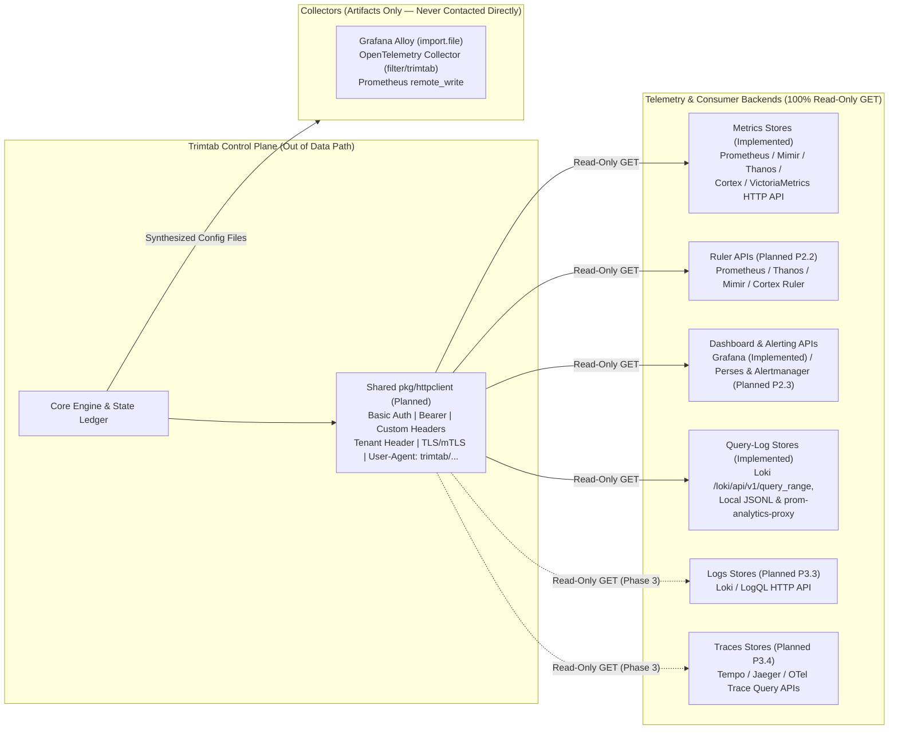

# Trimtab — Compatible Backends & Authentication Design

> **Related Docs:** [Architecture & Design](DESIGN.md) | [Implementation Plan](PLAN.md) | [Checkpoint](CHECKPOINT.md)

## 1. Design Principles

Trimtab is built around three connectivity and security principles:

1. **Out of the data path:** Trimtab never proxies ingestion or query traffic and never connects directly to telemetry collectors (such as Grafana Alloy, OpenTelemetry Collector, or Prometheus agents) during normal operation. It inspects control-plane and storage APIs asynchronously and emits declarative drop configurations for your collectors or GitOps workflows.
2. **Strictly Read-Only against telemetry backends:** Every integration against metrics, logs, traces, ruler, and dashboard backends uses read-only HTTP `GET` APIs. Trimtab never mutates TSDB data, log streams, trace data, dashboards, or ruler rules on remote telemetry backends.
3. **Lean, universal authentication:** Telemetry backends sit behind predictable HTTP auth boundaries—in-cluster plain HTTP or service-mesh mTLS, HTTP Basic Auth, Bearer Tokens, Custom Header Auth (`Env` or `File`-backed), multi-tenant headers (`X-Scope-OrgID`), and standard TLS/mTLS. Supporting these primitives cleanly with the Go standard library covers virtually any self-hosted or hosted telemetry backend without pulling in heavy, vendor-specific authentication SDKs.

---

## 2. High-Level Connectivity Topology



---

## 3. Compatible Backends by Signal

### 3.1 Metrics Backends (Phase 1 – Phase 2)

#### A. TSDB & PromQL Query API (`Implemented`)
Compatible with any **Prometheus HTTP API v1**-compliant metrics backend, including standalone **Prometheus**, **Mimir**, **Thanos Query**, **Cortex**, and **VictoriaMetrics**.

| Endpoint | Purpose in Trimtab | Notes |
| :--- | :--- | :--- |
| `GET /api/v1/label/__name__/values?start=...&end=...` | Historical metric family discovery across `minObservationWindow` | Decouples discovery from ~2h TSDB head blocks (Safety Invariant #5). |
| `GET /api/v1/metadata` | Metric type (`counter`, `gauge`, `histogram`, `summary`) and help text | Falls back cleanly to naming heuristics if partial or unavailable. |
| `GET /api/v1/status/tsdb` | Per-metric active series counts | Planned enhancement: pass `?limit=<N>` (avoiding default top-10 cap) and batched `count by (__name__)` fallback for scoped selectors or backends without `/status/tsdb`. |
| `GET /api/v1/status/runtimeinfo` | Local TSDB retention inspection | Emits a warning (never hard-fails) if local retention is shorter than `minObservationWindow`. |
| `GET /api/v1/labels?match[]=...` | Label keys on top-cardinality families | Drives `without`-based unused-label collapse advisories. |
| `GET /api/v1/query` | `count(count without (...) (m))` collapse estimation | Runs bounded PromQL instant queries for top families. |

- **Base URL path prefixes:** Gateways exposing Prometheus APIs under non-root prefixes (such as `/prometheus` or `/api/prom`) work automatically by setting `inventory.prometheusURL` to the prefix URL (e.g., `https://mimir.example.internal/prometheus`).
- **Multi-tenancy:** Tenant-isolated metrics backends use the `X-Scope-OrgID` header (via static `headers` today, or first-class `inventory.tenantID` in the planned HTTP client layer).
- **Single-cluster scoping (Planned):** Adding an optional `inventory.selector` (e.g., `cluster="staging-a"`) allows testing or auditing one cluster inside a shared multi-cluster metrics store while still checking usage globally.

#### B. Ruler APIs (`Planned — Phase 2.2`, `pkg/usage/ruler/`)
Distributed rulers evaluate alerting and recording rules internally and write directly to storage, **bypassing query frontends**. As a result, ruler alerting rules do not appear in query-frontend query logs.

| Backend Type | Read-Only Endpoint | Usage Semantics |
| :--- | :--- | :--- |
| **Mimir / Cortex Ruler** | `GET /prometheus/config/v1/rules` (with `X-Scope-OrgID`) | Returns multi-namespace YAML rule groups. Alerting rules become live sinks (`OriginRulerAlert`); recording rules feed `ResolveRecordingRuleDAG` only (Invariant #2). |
| **Prometheus / Thanos Ruler** | `GET /api/v1/rules` | Returns JSON rule groups with the same alert-sink vs. recording-rule DAG separation. |

- Ruler endpoints typically share the same base gateway, tenant header, and read credentials as the metrics query endpoint (requiring read permission for rules alongside metrics).

#### C. Dashboards, Alerting & Static Consumers
- **Grafana HTTP API (`Implemented`, `pkg/usage/grafana/`):**
  - Calls `GET /api/search?type=dash-db`, `GET /api/dashboards/uid/{uid}`, and `GET /api/v1/provisioning/alert-rules` (with planned pagination on `/api/search`, optional `/api/ruler/grafana/api/v1/rules` support, and datasource-type filtering so LogQL/TraceQL panels on multi-signal dashboards are not parsed as PromQL).
  - Also supports local dashboard JSON directories (`dashboardsDir`) and exported alert JSON (`alertRulesPath`) with zero network calls.
- **Prometheus Rule YAML Files (`Implemented`, `pkg/usage/promrules/`):**
  - Local file/glob YAML reader scanning alerting rules, recording rules, and Go template label references (`{{ $labels.* }}`).
- **Ecosystem & Kubernetes Static Consumers (`Planned — Phase 2.2 & 2.3`):**
  - `pkg/usage/k8sconsumers/`: KEDA `ScaledObject`/`ScaledJob`, `prometheus-adapter`, Argo Rollouts `AnalysisTemplate`, and Flagger `MetricTemplate`/`Canary` (via Git YAML globs or in-cluster read-only RBAC).
  - `pkg/usage/alertmanager/`: Alertmanager YAML/API (`group_by`, matchers, receiver templates) to protect alert-routing labels.
  - `pkg/usage/perses/` & `pkg/usage/slo/`: Perses dashboard JSON/YAML/API and Sloth/Pyrra SLO specs.

#### D. Runtime Query-Log Backends (`Implemented` — Mandatory for Drops per Invariant #1)
Static consumers alone miss ad-hoc scripts, autoscalers, and external callers. Trimtab requires runtime query logs covering `>= minObservationWindow` before synthesizing any `DROP` rule:

- **Loki HTTP API (`Implemented`, `pkg/usage/querylog/loki.go`):**
  - Calls `GET /loki/api/v1/query_range` over bounded chunks with optional `X-Scope-OrgID`.
  - Parses both **Prometheus `query_log_file` JSON** shipped to Loki and **Mimir/Cortex `query-frontend` logfmt/JSON logs**.
  - *Planned hardening:* Forward pagination within chunks (`limit` continuation so high-volume query logs are never truncated), Mimir `param_query="..."` / `param_match[]="..."` logfmt extraction, and streaming `(query, origin, caller)` deduplication to bound memory across 30-day lookbacks.
- **File & Proxy Sources (`Implemented`, `pkg/usage/querylog/reader.go`):**
  - Globbed/gzipped Prometheus `query_log_file` JSONL files and `prom-analytics-proxy` JSON exports.

---

### 3.2 Logs Backends (`Planned — Phase 3.3`, `pkg/logs/`)

Logs remain strictly isolated in their own signal domain (`pkg/logs/`) so metrics modeling stays clean, while sharing `pkg/httpclient`, `pkg/state`, `pkg/actuator`, and `pkg/report`:

- **Compatible Backends:** Any **Loki / LogQL HTTP API**-compatible log store (with pluggable adapters for other structured log query backends).
- **Read-Only Discovery & Usage APIs:**
  - Volume & cardinality metadata: `/loki/api/v1/index/volume`, `/loki/api/v1/index/stats`, `/loki/api/v1/labels`, `/loki/api/v1/label/{name}/values`.
  - Log query audit / noisy-pattern sampling: `/loki/api/v1/query_range` and log-gateway query logs to identify high-volume unqueried streams (e.g., verbose `debug` or health-check logs) for collector drop or cold-storage routing rules.

---

### 3.3 Traces Backends (`Planned — Phase 3.4`, `pkg/traces/`)

Traces use span volume and error/latency tail characteristics rather than series counts:

- **Compatible Backends:** **Tempo HTTP API**, **Jaeger Query HTTP API**, and OpenTelemetry-compatible trace query backends (optionally paired with span metrics stored in a Prometheus-compatible metrics store).
- **Read-Only Discovery & Usage APIs:**
  - Trace search, tag/attribute discovery, and TraceQL / span-metrics queries (`/api/search`, `/api/v2/search/tags`, `/api/metrics/query_range` on Tempo-compatible APIs; `/api/services`, `/api/traces` on Jaeger-compatible APIs).
  - Audits span volume by service, operation, and status against trace usage to synthesize OpenTelemetry Collector tail-sampling policies (`probabilistic`, `status_code`, `latency`).

---

### 3.4 Non-Telemetry Control Integrations (`Planned — Phase 2.5 & 2.6`)

These optional control integrations sit outside telemetry backends:

- **Kubernetes API (`Phase 2.6` Operator):** Read-only `ServiceAccount` RBAC (`ClusterRole` get/list/watch on `ScaledObject`, `PrometheusRule`, `AnalysisTemplate`, `Canary`) plus namespace-scoped read/write on Trimtab CRDs (`trimtab.io/v1alpha1`) and synthesized `ConfigMap`s.
- **Git Provider REST APIs (`Phase 2.5` GitOps Actuator):** Scoped repository token (`GITHUB_TOKEN` / `GITLAB_TOKEN` via environment variable) used exclusively to open tranched drop PRs, dead-rule cleanup PRs, and urgent Regret Revert PRs.

---

### 3.5 Backends Trimtab Does NOT Connect To

- **Telemetry Collectors (Grafana Alloy, OpenTelemetry Collector, Prometheus Agents):** Never contacted directly over the network. Trimtab generates `trimtab.alloy`, `trimtab-rules.yaml`, or `write_relabel_configs` artifacts behind a one-time insertion point managed by your configuration or GitOps pipeline. *(Phase 3.5 OpAMP break-glass is an optional future addition.)*
- **Write / Admin Paths on Telemetry Stores:** Trimtab never calls `remote_write`, `/api/v1/admin/tsdb/delete_series`, Loki push APIs, Tempo ingestion, or Grafana dashboard/rule write endpoints.

---

## 4. Authentication & Transport Model

### 4.1 Shared HTTP Client Layer (`pkg/httpclient` — Planned)

Currently, HTTP transport and header logic live independently in `pkg/inventory/prometheus`, `pkg/usage/querylog`, and `pkg/usage/grafana`. Consolidating them into a single `pkg/httpclient` package built purely on Go stdlib (`net/http`, `crypto/tls`, `crypto/x509`) provides uniform auth, TLS/mTLS, tenant routing, secret redaction, self-query tagging, and retry behavior across all current and future backends.

### 4.2 Supported Authentication Mechanisms

Five simple mechanisms cover virtually every self-hosted and hosted telemetry backend:

| Mechanism | Config Fields | Typical Use Case |
| :--- | :--- | :--- |
| **1. None (In-Cluster / Mesh)** | *(no auth fields)* | Internal Kubernetes `ClusterIP` services or service-mesh mTLS (optionally paired with `tenantID`). |
| **2. HTTP Basic Auth** | `auth.basicAuth.username` (`usernameEnv` / `usernameFile`) + `password` (`passwordEnv` / `passwordFile`) | Reverse proxies, multi-tenant gateways, and hosted Prometheus/Loki/Tempo/Ruler HTTP APIs using `<tenant-or-instance-id>:<api-token>`. |
| **3. Bearer Token** | `auth.bearerToken` (`bearerTokenEnv` / `bearerTokenFile`) | Grafana Service Account tokens, API gateway tokens, JWTs, or Kubernetes projected `ServiceAccount` tokens. |
| **4. Custom Header Auth** | `headers` (non-secret) + `headersEnv` / `headersFile` (secret) | Any API-key gateway, auth-proxy header, tenant routing header, or custom backend auth header (`X-API-Key`, `X-Auth-Token`, etc.) without vendor-specific auth SDKs. |
| **5. TLS / mTLS** | `auth.tls.caFile`, `certFile`, `keyFile`, `serverName`, `insecureSkipVerify` | Private internal CAs and mutual-TLS client-certificate gateways. |

- **Multi-Tenant Header (`tenantID`):** Sets `X-Scope-OrgID: <tenantID>` on every request (including federated multi-tenant read syntax such as `tenant-a|tenant-b` where supported by the backend).

### 4.3 Unified `trimtab.yaml` Configuration Shape (Planned)

Each backend block embeds the same reusable `auth`, `tenantID`, `headers`, `headersEnv`, and `headersFile` schema:

```yaml
inventory:
  prometheusURL: https://metrics.internal/prometheus
  tenantID: "prod-tenant"              # sets X-Scope-OrgID
  selector: 'cluster="cluster-a"'      # optional cluster/label scoping for inventory
  auth:
    basicAuth:
      usernameEnv: METRICS_USER        # or literal username / usernameFile
      passwordEnv: METRICS_PASSWORD    # or passwordFile
    tls:
      caFile: /etc/trimtab/certs/internal-ca.crt

usage:
  rulers:
    - type: mimir                      # "mimir" | "prometheus" | "thanos"
      url: https://metrics.internal
      tenantID: "prod-tenant"
      auth:
        basicAuth:
          usernameEnv: METRICS_USER
          passwordEnv: METRICS_PASSWORD

  queryLogs:
    - loki:
        url: https://logs.internal
        tenantID: "prod-tenant"
        query: '{component="query-frontend"}'
        auth:
          # Example using Custom Header Auth instead of Basic/Bearer:
          headersEnv:
            X-API-Key: LOKI_API_KEY
          # Or mount rotating tokens via Kubernetes Secrets / CSI:
          # headersFile:
          #   X-API-Key: /var/run/secrets/trimtab/loki-api-key

  grafana:
    url: https://grafana.internal
    auth:
      bearerTokenFile: /var/run/secrets/trimtab/grafana-token
      # or bearerTokenEnv: GRAFANA_TOKEN
```

#### Kubernetes Secret Injection & Rotation
- **`*Env` fields** (`bearerTokenEnv`, `usernameEnv`, `passwordEnv`, `headersEnv`): Ideal for `CronJob` / `Job` pods using `envFrom: secretRef`. Secrets never appear in GitOps YAML or `trimtab.yaml`.
- **`*File` fields** (`bearerTokenFile`, `usernameFile`, `passwordFile`, `headersFile`): Ideal for long-running pods (`trimtab serve` in P2.4 or the Operator in P2.6) using mounted Kubernetes `Secret`s or CSI secret drivers—`pkg/httpclient` re-reads file-backed credentials on a short TTL so rotated tokens take effect with zero pod restarts.

### 4.4 Least-Privilege Read-Only Scope Reference

Operators provisioning tokens for Trimtab should grant **read-only scopes only**:

| Backend | Minimum Required Permissions | Never Grant |
| :--- | :--- | :--- |
| **Metrics Store** | Metrics read (`metrics:read`) | Metrics write, TSDB delete/admin |
| **Ruler API** | Rules read (`rules:read`) | Rules write/delete |
| **Query-Log / Logs Store** | Logs read (`logs:read`) | Logs write/push |
| **Traces Store** *(Phase 3)* | Traces read (`traces:read`) | Traces write |
| **Grafana / Dashboards** | Dashboards read (`dashboards:read`) + Alert rules read (`alert.provisioning:read` or `alert.rules:read`) | Admin, dashboard edit, datasource edit, alert write |

---

## 5. Security, Safety & Operational Invariants

1. **Fail-Closed Auth Validation & HTTP Errors:**
   - Configuring mutually exclusive primary auth modes on the same backend (e.g., setting both `basicAuth` and `bearerToken*`) fails config validation immediately.
   - If a referenced `*Env` variable or `*File` secret is unset, missing, or empty, Trimtab fails immediately rather than sending an empty `Authorization` header.
   - `HTTP 401` and `HTTP 403` responses are **never retried** and immediately populate `HardFetchErrors`, aborting drop synthesis per **Safety Invariant #4** ([DESIGN.md](DESIGN.md#L70-L74)).
2. **Zero Credential Leakage:**
   - Values sourced from `bearerToken*`, `basicAuth`, `headersEnv`, `headersFile`, `Authorization`, and `Cookie` are stripped/redacted from error messages, CLI reports, warnings, and `.trimtab-state.json`.
   - `insecureSkipVerify: true` is permitted only as an explicit opt-in and emits a visible warning in `AuditReport`.
3. **Self-Query Feedback-Loop Prevention (`User-Agent: trimtab/<version>`):**
   - When Trimtab evaluates `count(count without (...))` or `count by (__name__)` queries against a metrics store, the metrics store's query frontend may log Trimtab's own queries into the query log!
   - If unexcluded, Trimtab would read its own inspection queries on the next run as `api-user` traffic—falsely protecting unused metrics or triggering false Regret events.
   - `pkg/httpclient` will tag every outbound request with `User-Agent: trimtab/<version>`, and `pkg/usage/querylog` will automatically classify `trimtab/` callers as `excluded-explorer` by default.
4. **Bounded Retries & Timeouts:**
   - Idempotent `GET` calls retry only transient errors (`429` honoring `Retry-After`, `502`, `503`, `504`, and connection resets) with bounded exponential backoff + jitter.
5. **Pre-Flight Check (`trimtab doctor` — Planned):**
   - A read-only command (`trimtab doctor --config trimtab.yaml`) that tests reachability, TLS verification, authentication, `X-Scope-OrgID`, and read permissions across every configured backend before running audits or deploying CronJobs.

---

## 6. Current vs. Planned Implementation Status

| Capability | Current Codebase Status | Target Package(s) |
| :--- | :--- | :--- |
| Metrics `bearerToken` + static `headers` | **Implemented** | `pkg/config`, `pkg/inventory/prometheus` |
| Loki `tenantID` (`X-Scope-OrgID`) + `bearerToken` + static `headers` | **Implemented** | `pkg/config`, `pkg/usage/querylog/loki.go` |
| Grafana `apiKey` (Bearer) + static `headers` | **Implemented** | `pkg/config`, `pkg/usage/grafana` |
| Reusable `HTTPAuthConfig` (Basic Auth, `*Env`, `*File`, `headersEnv`/`File`, TLS/mTLS, `inventory.tenantID`) | **Planned** | `pkg/config`, `pkg/httpclient` |
| `User-Agent: trimtab/...` self-query auto-exclusion + `trimtab doctor` | **Planned** | `pkg/httpclient`, `pkg/usage/querylog`, `cmd/trimtab` |
| Mimir / Thanos / Prometheus Ruler client | **Planned (P2.2)** | `pkg/usage/ruler` |
| Logs & Traces backend clients | **Planned (P3.3–P3.4)** | `pkg/logs`, `pkg/traces` |
