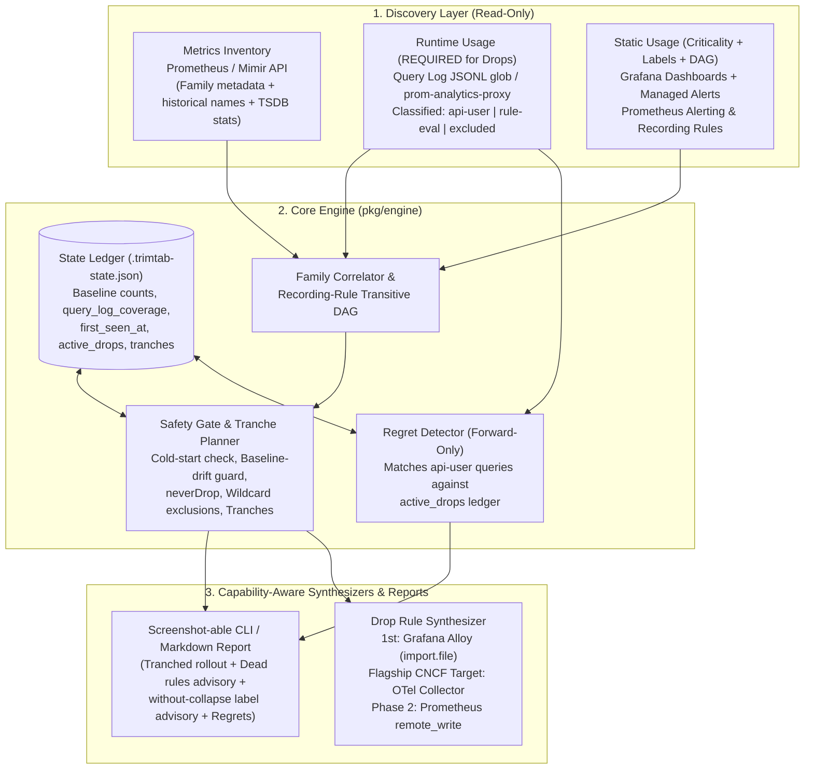

# Trimtab — Architecture & Design Document

> **Project Name:** Trimtab (`trimtab.io`)
> **Status:** Phase 1 & Phase 1.1 Implemented (See [docs/CHECKPOINT.md](CHECKPOINT.md))
> **Language:** Go
> **Target Ecosystem:** Cloud Native / CNCF Observability (OpenTelemetry, Prometheus, Grafana Alloy, Mimir, Loki, OpenCost, Argo CD / Flux)
> **Related Docs:** [Backends & Authentication](BACKENDS_AND_AUTH.md) | [Implementation Plan](PLAN.md) | [Checkpoint](CHECKPOINT.md)

> *In naval architecture, a **trim tab** is a tiny control surface on a ship's rudder that steers a massive vessel with minimal force and zero drag. **Trimtab** applies the same principle to cloud-native observability: a lightweight, out-of-the-data-path control plane that audits real telemetry usage, rolls out safe tranched drops, detects post-drop regret, and steers telemetry pipelines via GitOps.*

---

## 1. Problem Statement & Motivation

Observability volume grows faster than application traffic, and telemetry bills routinely rival compute infrastructure spend. Grafana Labs' published benchmarks report **20–50% active series reduction across 150+ customers** through Adaptive Metrics.

Today, however, the observability optimization landscape is bifurcated:
- **Proprietary SaaS** (Grafana Cloud Adaptive Metrics/Logs, Datadog Metrics without Limits, Chronosphere Control Plane, Edge Delta, Sawmills) delivers closed-loop reduction behind vendor lock-in.
- **Open-Source Tooling** is split between **read-only static/proxy analyzers** (`mimirtool analyze`, `perses/metrics-usage`, `prom-analytics-proxy`, `metric_usage_exporter`) and **unopinionated pipeline plumbing** (OpenTelemetry Collector, Grafana Alloy, `opentelemetry-operator`, OpAMP).

**Trimtab** bridges this gap as a **vendor-neutral, open-source adaptive telemetry control plane**:
- **Metrics first (Phase 1)** — scoped explicitly to **single tenant, usage evaluated globally per metric family** — while keeping clean orchestration boundaries so **Logs** and **Traces** plug in cleanly later without distorting the metrics model.
- **Strictly complementary** to existing CNCF & OSS projects — replaces nothing.
- **Out of the data path** — zero ingestion latency, zero single point of failure, and zero telemetry loss if Trimtab crashes or is uninstalled.

---

## 2. Ecosystem Positioning (Strictly Complementary)

| Existing Tool | Relationship with Trimtab |
| :--- | :--- |
| **Prometheus / Mimir / Thanos / VictoriaMetrics** | Trimtab reads TSDB head stats, historical metric names, and query logs. Never replaces storage or scraping. |
| **Grafana Alloy** *(Phase 1 First Delivery)* | Trimtab synthesizes a standalone `import.file` module (`trimtab.drop_unused`) behind a one-time `forward_to` insertion point on the Prometheus-native pipeline path. |
| **OpenTelemetry Collector** *(Flagship CNCF Target)* | Trimtab synthesizes `filter/trimtab` rules behind a one-time `--config` insertion point (exact-match only; never guesses reverse OTLP translations). |
| **Grafana / Perses** | Trimtab reads dashboard definitions & Grafana-managed alert rules to identify usage and label dependencies; exports FinOps metrics to visualize waste inside Grafana/Perses. |
| **`prom-analytics-proxy`** | Optional plug-in runtime query-log source—users already running it feed live query analytics directly into Trimtab. |
| **OpenCost** | Phase 2 exports per-team telemetry cardinality & cost metrics (`trimtab_team_*`) designed to sit beside OpenCost compute dashboards. |
| **Argo CD / Flux** | Phase 2 opens auditable GitOps PRs (tranched drop rollouts + automated Regret Revert PRs) against machine-owned rule files; Argo CD/Flux handle safe rollout and drift. |

For the full matrix of compatible Metrics, Logs, and Traces backends, read-only endpoints, and the Basic Auth / Bearer / Custom Header Auth / TLS connectivity model, see [Backends & Authentication Design](BACKENDS_AND_AUTH.md).

---

## 3. Non-Negotiable Safety & Design Invariants

Real production observability pipelines have sharp failure modes. Trimtab treats the following invariants as hard engineering requirements, not optional polish:

### 3.1 Out of the Data Path
Trimtab never proxies ingestion traffic or mutates metrics in flight. It operates strictly asynchronously in the control/advisory plane.

### 3.2 Runtime Query Log Is Mandatory for Any `DROP` (and Cold-Start UX)
Static analysis of dashboards and rule files is **not** a complete usage surface. Critical metric consumers routinely live outside dashboards and YAML rules:
- **KEDA `ScaledObject`s** and **`prometheus-adapter` (HPA)** — dropping a scaling metric causes silent autoscaling failure with no alert.
- **Argo Rollouts** and **Flagger** `AnalysisTemplate`s — dropping a canary metric fails rollouts or promotes bad releases blindly.
- **Grafana-managed alert rules** (stored in Grafana's database, not Prometheus YAML rule files).
- **Mimir/Thanos ruler APIs**, **Sloth/Pyrra SLOs**, ad-hoc scripts, and cron reports.

**Rules:**
- The **runtime query log** is the only source that observes every consumer. **Without a runtime query log, Trimtab runs strictly in Report-Only mode** and never synthesizes `DROP` rules (`MEDIUM` confidence never triggers a drop).
- **Explicit Cold-Start Coverage:** Real clusters rarely have 30 days of query logs on day one. Trimtab tracks `query_log_coverage` (e.g., `3/30 days`) in the **State Ledger** and runs in **report-only mode with projected savings** until `query_log_coverage >= minObservationWindow` and ledger/history coverage satisfies the window.
- **Retention Handling:** Local Prometheus TSDB retention (often 15d when remote-writing to Mimir/Thanos) is **not** query-log retention. Trimtab warns if local TSDB retention is shorter than `minObservationWindow` and relies on the persistent State Ledger (`first_seen_at`) rather than hard-failing on local TSDB retention.
- **Query Log Plumbing (Phase 1 vs. Phase 1.1):**
  - Prometheus `query_log_file` does not self-rotate, and HA Prometheus pairs require logs from every replica. Phase 1 accepts a **glob/directory of rotated JSONL files** (handling logrotate and HA replicas cleanly).
  - Phase 1.1 adds a **Loki-backed query-log source** (for clusters shipping `query_log_file` or Mimir `query-frontend` logs to Loki). Note: Mimir's `query-frontend` logs all API queries when `log_queries_longer_than: 0s` (chatty at high QPS) while Mimir Ruler bypasses `query-frontend`, making it cleanly separable from user queries as long as alerting rules are read from the Ruler API.

### 3.3 Query Log Origin Classification
Prometheus `query_log_file` records **both** HTTP API queries and internal rule evaluations. Counting recording-rule evaluations as user usage would mark every recording rule's input as "queried every 30s" and break dead-chain detection.
- Trimtab classifies every query-log entry into one of three origins:
  1. **`rule-eval`** (`ruleGroup != nil || httpRequest == nil`): Recording-rule evaluations feed **only** into the dependency DAG (never into live sinks). Alerting-rule evaluations are distinguished via static rule files / ruler API and treated as **live sinks**.
  2. **`api-user`** (`httpRequest != nil`, not excluded): Feeds directly into the live **USED** set.
  3. **`excluded-explorer`**: Matches configured `excludeSources` (e.g., cardinality explorer dashboards or known audit tools); ignored for usage protection.

### 3.4 Fail-Closed Against Partial Results (Baseline Drift Circuit Breaker)
A Grafana API token that loses access to folders returns `HTTP 200` with 20 dashboards instead of 140—not an error.
- Trimtab persists per-source object counts (`dashboards`, `grafana_alerts`, `prom_rules`, `query_log_entries`) in the **State Ledger** (`.trimtab-state.json`).
- If any source's count drops more than the configured threshold (default `>20%`) relative to the previous baseline, Trimtab **refuses to synthesize drop rules** until explicitly acknowledged (`--accept-baseline-shift`).
- Any hard fetch error from a configured source also aborts synthesis (fail-closed).

### 3.5 Tranched Rollout + Sanity Ceiling
Rather than dropping 47% of an estate in one terrifying change (or tripping a `maxDropPercent` circuit breaker on legitimate large waste):
- Trimtab splits eligible drops into **tranches** capped at `maxDropPercentPerTranche` (default `15%` of active series), ordered by **largest series savings first** and **never splitting a metric family across tranches**.
- Tranche `N+1` is gated on Tranche `N` completing a configurable `soakWindow` (default `7d` in prod, configurable) with **0 unresolved regrets**.
- A separate **sanity-abort ceiling** (`maxTotalDroppablePercent`, default `80%`) still hard-aborts synthesis if nearly the entire estate suddenly looks unused (indicating broken query-log wiring).

### 3.6 Observation Window Decoupled from TSDB Head Block
Prometheus `/api/v1/status/tsdb` only covers the active head block (~2 hours). Weekly batch jobs and CronJob metrics appear absent or brand-new in a head-block snapshot.
- Trimtab combines historical metric discovery (`/api/v1/label/__name__/values?start=...&end=...`) with persistent timestamps in the **State Ledger** (`first_seen_at`, `last_seen_at`, `last_queried_at`).
- A metric family whose `first_seen_at` is newer than `minObservationWindow` is never eligible for `DROP`.

### 3.7 Default `neverDrop` Meta-Monitoring Allowlist & Wildcard Exclusions
- **Default `neverDrop` patterns** (always protected unless explicitly overridden): `^up$`, `^ALERTS$`, `^ALERTS_FOR_STATE$`, `^scrape_.*`, `^prometheus_.*`, `^alloy_.*`, `^otelcol_.*`. Losing meta-monitoring metrics during a bug blinds operators to the bug itself.
- **Wildcard-Protector Detection:** A single cardinality-explorer dashboard containing `{__name__=~".+"}` would otherwise protect the entire estate. Trimtab flags any source matching `>50%` of inventory prominently in the report and supports explicit `excludeSources` (by dashboard UID, folder, tag, or query-log caller).

### 3.8 Histogram Families & Synthesizer Capabilities
Metrics must be modeled and dropped at the **Metric Family** level (grouping classic histogram `_bucket`, `_sum`, `_count`, `_created`, and summary quantiles + `_sum` + `_count`) so Trimtab never drops `_bucket` while accidentally leaving orphaned `_sum`/`_count` behind (or vice versa).
- **Partial-family optimization:** If queries only consume `*_count` or `*_sum` (never `*_bucket`), dropping *only* `*_bucket` is a valid, high-value reduction on Prometheus-relabel targets—but **impossible** in an OTel Collector `filter` processor (which drops entire OTLP metric instruments).
- **Capability Negotiation:** Every `Synthesizer` declares its `Capabilities` (e.g., `CanDropHistogramBucketsOnly bool`, `SupportedNamingModes []NamingMode`). The engine only synthesizes actions the target can actually express; unsupported actions are rendered as advisory notes.
- **Native Histograms:** Prometheus 3 / OTel Exponential Native Histograms are recognized as single-series instruments and never recommended for `_bucket`-only drops.

### 3.9 `DROP_DIMENSION` Is Advisory-Only in v1
Dropping a label in-flight does **not** safely reduce active series without aggregation:
- If remaining labels still uniquely identify every series (e.g., dropping `pod_uid` while `pod` remains), it saves index bytes and **zero billable series**.
- If remaining labels *do* collide, dropping without aggregating produces **duplicate sample errors** in Prometheus and **out-of-order / duplicate write rejections** in Mimir.
- **Collector sharding hazard:** A DaemonSet collector (Alloy/OTel) per node only sees its own node's series. Aggregating away `pod` on each node collides across nodes at remote write unless shard identity (`node` or collector ID) is preserved.
- **Recording rules** evaluate after ingestion and do not reduce ingest unless evaluated by a full local Prometheus that drops raw series in `remote_write[].write_relabel_configs` (impossible in Prometheus agent mode).

**v1 Policy:**
- Hard-protect histogram/summary and structural internals (`le`, `quantile`, `__name__`).
- Emit `DROP_DIMENSION` strictly as **advisory recommendations** (never synthesized into drop/transform rules in v1), paired with exact, cheap PromQL collapse estimates using **`without`**:
  ```promql
  # Current series count
  count(payments_http_duration_seconds_bucket)

  # Honest single-label removal test (returns ~today if `pod` still uniquely identifies series!)
  count(count without (pod_uid) (payments_http_duration_seconds_bucket))

  # Combined unused-labels collapse estimate
  count(count without (pod, pod_uid, instance) (payments_http_duration_seconds_bucket))
  ```
- True **shard-safe aggregation synthesis** (enforcing shard-granularity preservation) is deferred to Phase 3.

### 3.10 Closed-Loop Regret Detection (Forward-Only)
After drop rules are active, Trimtab records dropped metric families in the **State Ledger** (`active_drops`). On every subsequent run, Trimtab watches **API/user query logs** for queries matching an actively dropped metric family (which now return empty results).
- **Transparency:** Regret Detection is **forward-only**—samples dropped prior to regret firing are gone permanently; Regret stops *future* data loss.
- **Default Threshold = 1 (Bias Toward Safety):** Prometheus `query_log_file` does not carry end-user identity (`httpRequest.clientIP` is usually just Grafana's pod IP), and waiting for multiple callers would blind a single on-call SRE during a 3 AM SEV-1 outage. By default, **1 non-excluded query** fires a `RegretEvent`, removes the metric from synthesized drops, pins it in `neverDrop`, and blocks the next rollout tranche. (Optional `minRegretHits` / caller filters remain configurable for noisy environments.)
- **Phase 2 GitOps:** Automatically opens a **Revert PR** restoring the metric and adding it to the protected list.

---

## 4. High-Level Architecture



---

## 5. Signal-Boundary Philosophy (Pragmatic Multi-Signal Design)

Metrics, Logs, and Traces have fundamentally different "unused" semantics:
- **Metrics:** Unqueried families / unreferenced labels / dead recording-rule chains.
- **Logs:** High-volume noisy log patterns / unqueried log streams → drop debug/health or route cold to object storage.
- **Traces:** High-volume normal-path spans → tail-sampling policies.

To avoid distorting metrics with a leaky lowest-common-denominator abstraction:
- **Orchestration & lifecycle boundaries** (`StateLedger`, `BaselineSnapshot`, `RegretEvent`, `TrancheState`, `AuditSummary`, `TeamBudget`, `Actuator`, `GeneratedArtifact`) are signal-agnostic.
- **Signal domain engines** stay idiomatic per signal: `pkg/metrics` (Phase 1, single-tenant global per metric family), `pkg/logs` (Phase 3), `pkg/traces` (Phase 3).

---

## 6. Usage, Label & Dead-Chain Extraction Specification

### 6.1 PromQL AST Extractor (`pkg/usage/promql`)
Built on `github.com/prometheus/prometheus/promql/parser`. For every parsed expression:
1. **Metric selectors:** Exact `__name__` matches and regex matchers (`{__name__=~"..."}`), mapped back to Metric Families.
2. **Label preservation semantics:**
   - `sum by (namespace, status) (m)` → explicitly uses `{namespace, status}`.
   - `sum without (pod) (m)` → preserves **all labels except `pod`** (`preservesAllExcept: ["pod"]`).
   - Plain `rate(m[5m])` or bare `m` → preserves **all labels** (`preservesAll: true`), so no label on `m` is marked unused due to this expression.
3. **String-argument label references:**
   - `label_replace(v, dst, repl, src, regex)` → marks `src` (and `dst`) as used.
   - `label_join(v, dst, sep, src1, src2, ...)` → marks every `srcN` (and `dst`) as used.
4. **Vector matching & modifiers:** `on (...)`, `ignoring (...)`, `group_left(...)`, `group_right(...)`.

### 6.2 Non-PromQL Label References
- **Grafana Dashboards (`pkg/usage/grafana`):**
  - Panel target PromQL expressions + template variable queries (`label_values(metric, label)`, `query_result(...)`).
  - `legendFormat` templates (`{{pod}}`, `{{instance}}`), panel/data links (`${__field.labels.pod}`), field overrides, and panel transformations referencing label names.
  - **Grafana-managed Alert Rules** via Grafana Alerting API (`/api/v1/provisioning/alert-rules` / ruler API).
- **Prometheus Rule Files (`pkg/usage/promrules`):**
  - Alerting & recording rule `expr` fields (alerting rules = live sinks; recording rules = DAG nodes).
  - Go template label references in `annotations` and `labels` (`{{ $labels.pod }}`, `{{ $labels.instance }}`).

### 6.3 Dead Recording-Rule Chains (`pkg/engine/dag.go`)
Trimtab builds a directed dependency graph from recording rules (`source_metric -> R1 -> R2`) and walks backwards from **live sinks** (`api-user` query-log hits, active dashboard panels, alerting rules):
- If `R2` has any live sink → `R1` and `source_metric` are transitively **USED**.
- If neither `R2` nor `R1` has any live sink → the chain is **DEAD**.
- **Two-part action for a dead chain:** Because the ruler writes recorded series directly to TSDB/Mimir (bypassing Alloy/OTel), dropping `source_metric` at the collector does **not** delete `R1`/`R2` (and if a rule uses `or vector(0)`, it will continue emitting `0` series until removed). Trimtab therefore:
  1. Drops `source_metric` at the collector (only if `source_metric` has no other live consumers).
  2. Emits a dedicated **"Dead Recording Rules to Delete"** advisory list naming the exact rule file, group, and rule name (automated as a rule-file PR in Phase 2).

---

## 7. One-Time Insertion Point Strategy (Synthesizers)

Standalone drop files cannot run unless the collector pipeline routes telemetry through them. Trimtab uses a **one-time insertion point** contract: a human wires the plumbing **once**, and Trimtab owns **only** the generated file behind it.

### 7.1 Phase 1 (First Delivery): Grafana Alloy (`import.file` Mode)
Ships first for immediate dogfooding. **Insertion contract:** `prometheus.relabel` operates on the **Prometheus-native pipeline path**—this covers both `prometheus.scrape` pipelines **and** OTLP pipelines routed through `otelcol.exporter.prometheus` → `trimtab.drop_unused` → `prometheus.remote_write` (where metric names are already Prometheus names, avoiding lossy reverse translation). Pure `otelcol.*` OTLP-to-OTLP pipelines require the OTel insertion contract below.

**Human-owned `config.alloy` (wired once):**
```hcl
import.file "trimtab" {
  filename = "/etc/alloy/trimtab.alloy"
}

trimtab.drop_unused "default" {
  forward_to = [prometheus.remote_write.prod.receiver]
}

// Upstream prometheus.scrape or otelcol.exporter.prometheus sets:
// forward_to = [trimtab.drop_unused.default.receiver]
```

**Trimtab-owned `/etc/alloy/trimtab.alloy` (100% machine-managed):**
```hcl
// Managed by Trimtab — DO NOT EDIT MANUALLY
// Audit: 2026-11-21 | Coverage: 30/30d | Tranche 1 of 4 (14.8% series) | Regrets: 0
declare "drop_unused" {
  argument "forward_to" {
    optional = false
  }
  export "receiver" {
    value = prometheus.relabel.trimtab_drop.receiver
  }

  prometheus.relabel "trimtab_drop" {
    forward_to = argument.forward_to.value

    // Omitted (valid pass-through) when 0 metrics are dropped.
    // Prometheus/Alloy relabel regexes are implicitly anchored.
    rule {
      source_labels = ["__name__"]
      regex         = "checkout_legacy_cart_gauge|orders_deprecated_latency_seconds_(bucket|sum|count|created)"
      action        = "drop"
    }
  }
}
```
- **Capabilities:** `CanDropFamily: true`, `CanDropHistogramBucketsOnly: true`.

### 7.2 Flagship CNCF Target (Phase 1.1): OpenTelemetry Collector (`--config` Insertion Point)
Primary long-term CNCF target. The human wires `filter/trimtab` into `service.pipelines.metrics.processors` **once** and runs `--config=file:base.yaml --config=file:trimtab-rules.yaml`.

**Metric Name Contract (No Heuristic Reverse-Guessing):**
Because Prometheus translation (`UnderscoreEscapingWithSuffixes`) is mathematically lossy (`.`, `-`, `/`, and `_` all collapse to `_`), Trimtab **never guesses** reverse OTLP names from Prometheus query logs:
- Works deterministically for **Prometheus-scraped metrics** (`prometheus` receiver), **Prometheus 3 `NoTranslation` (UTF-8)** pipelines, or pipelines supplying an **exact OTLP-to-Prometheus mapping** (e.g., from collector metadata / explicit mapping config).
- When a metric's OTLP name cannot be deterministically verified, the OTel synthesizer **skips it with an advisory warning** rather than risking a wrong drop or a silent no-op.

**Human-owned `base.yaml` (wired once):**
```yaml
processors:
  batch: {}
service:
  pipelines:
    metrics:
      receivers: [prometheus]
      processors: [filter/trimtab, batch] # One-time insertion point
      exporters: [prometheusremotewrite]
```

**Trimtab-owned `trimtab-rules.yaml` (100% machine-managed):**
```yaml
# Managed by Trimtab — DO NOT EDIT MANUALLY
# Never defines `service:` so user pipeline lists are never overwritten.
processors:
  filter/trimtab:
    error_mode: ignore
    metrics:
      metric:
        # 0 live consumers in 30d | 42,800 series | Tranche 1 of 4
        - 'name == "checkout_legacy_cart_gauge"'
```
- **No-op rule:** When 0 metrics are dropped, emits a valid non-matching OTTL predicate (`'name == "__trimtab_noop__"'`) rather than an empty `{}` map.
- **Capabilities:** `CanDropFamily: true`, `CanDropHistogramBucketsOnly: false` (OTel `filter` drops whole instruments; bucket-only savings render as advisory).

### 7.3 Phase 2 Target: Prometheus `remote_write`
Because Prometheus has no global `metric_relabel_configs` hook, Trimtab targets **`remote_write[].write_relabel_configs`**—the only global hook and where remote-write / SaaS spend occurs.

### 7.4 Later Add-on: Direct Alloy Config Import
Once core Trimtab is mature, an optional add-on will parse existing Alloy configs directly (for pipeline topology discovery, shard detection, and existing drop-rule deduplication).

---

## 8. Phased Roadmap

### Phase 1 — Focused Metrics CLI MVP (Single Tenant, Global Per Metric Family)
**North-star demo:** One command (`trimtab analyze`) prints a screenshot-able report showing query-log coverage, tranched rollout status, dead recording-rule advisories, exact `without`-based label-collapse advisories, and Regret Detection.

- **Inventory:** Prometheus / Mimir HTTP API (family metadata via `/api/v1/metadata`, historical metric names, `/api/v1/status/tsdb`, bounded `without` collapse queries) + offline JSON fixture loader for instant local demo/CI.
- **Usage Sources (3):**
  1. **Query Log (Required for drops):** Glob/directory of Prometheus `query_log_file` JSONL files (plus `prom-analytics-proxy` JSON export), with `api-user` / `rule-eval` / `excluded-explorer` classification.
  2. **Grafana:** Dashboards (API or local JSON: PromQL, `legendFormat`, template vars, links/overrides/transforms) + **Grafana-managed Alert Rules**.
  3. **Prometheus Rule Files:** Alerting & recording rules YAML (with transitive closure DAG + Go template label scanning).
- **Core Engine:** PromQL AST extractor, Metric Family grouper, State Ledger (cold-start coverage, baseline drift guard, observation window, tranches, `active_drops`), default `neverDrop` allowlist, wildcard-protector detection/exclusion, tranched rollout planner, `without`-based advisory label collapse, and forward-only Regret Detection.
- **Synthesizers (Capability-Aware):**
  1. **First:** Grafana Alloy `import.file` module (`pkg/synthesizer/alloy`).
  2. **Next (Phase 1.1 — Flagship CNCF Target):** OpenTelemetry Collector `--config` `filter/trimtab` (`pkg/synthesizer/otel`) + Loki-backed query-log source.
- **Output:** Screenshot-able terminal summary + Markdown/JSON report + synthesized rules file.

### Phase 2 — "OpenCost for Telemetry", K8s Operator, GitOps & Expanded Consumers
- Per-team attribution resolver chain (metric labels → K8s namespace/workload labels → static/Backstage mappings) and team budgets (`TelemetryBudget` CRD + Prometheus `/metrics` FinOps exporter).
- `controller-runtime` Kubernetes Operator (`TelemetryAuditPolicy`, `TelemetryBudget`, `TelemetryRecommendation` with `breakGlassUntil`).
- GitHub & GitLab GitOps PR Actuator (tranched drop PRs, dead recording-rule cleanup PRs, and **automated Regret Revert PRs**).
- Multi-cluster / per-selector drop scoping.
- Expanded static usage sources: **KEDA `ScaledObject`**, **`prometheus-adapter`**, **Argo Rollouts / Flagger `AnalysisTemplate`**, **Alertmanager configs**, **Perses dashboards**, **Sloth/Pyrra SLOs**, **Mimir/Thanos Ruler API**.
- Prometheus `remote_write[].write_relabel_configs` synthesizer.

### Phase 3 — Shard-Safe Aggregation, Multi-Signal (Logs & Traces) & OpAMP
- Shard-safe aggregation synthesizer (enforcing collector shard-granularity preservation).
- Direct Alloy config import add-on.
- **Logs (`pkg/logs`):** Loki index stats + LogQL pattern analysis + drop/cold-routing rules.
- **Traces (`pkg/traces`):** Span volume inventory + tail-sampling policy synthesis.
- **OpAMP Break-Glass Actuator:** Instant temporary override during SEV-1 incidents.

---

## 9. Planned Repository Layout (Go)

```text
trimtab/
├── AGENT.md                     # High-signal guide for future coding/agent sessions
├── README.md                    # Quickstart, demo screenshot, insertion-point docs
├── docs/
│   ├── BACKENDS_AND_AUTH.md     # Compatible Metrics/Logs/Traces backends & auth model
│   └── DESIGN.md                # This architecture & design document
├── cmd/trimtab/                 # CLI entrypoint (`analyze`, `synth`, `version`)
├── pkg/
│   ├── config/                  # `trimtab.yaml` schema, defaults & validation
│   ├── metrics/                 # MetricFamily, SeriesStats, UsageIndex, AuditReport, Capabilities
│   ├── state/                   # State Ledger (baselines, query_log_coverage, first_seen, tranches, active_drops)
│   ├── inventory/
│   │   └── prometheus/          # Prometheus/Mimir API client + offline fixture loader
│   ├── usage/
│   │   ├── promql/              # PromQL AST extractor (by/without/bare/label_replace/label_join/regex)
│   │   ├── querylog/            # Globbed JSONL parser + origin classifier (api-user/rule-eval/excluded)
│   │   ├── grafana/             # Grafana dashboards (API/JSON + legend/vars/links) & managed alerts
│   │   └── promrules/           # Prometheus rule YAML scanner + Go template label scanner
│   ├── engine/
│   │   ├── family.go            # Metric family grouper (classic/native histograms, summaries)
│   │   ├── dag.go               # Recording-rule transitive closure DAG & dead-chain detector
│   │   ├── analyzer.go          # Usage correlator, cold-start gating, without-collapse estimator
│   │   ├── safety.go            # Baseline-drift guard, neverDrop, wildcard detector, tranche planner
│   │   └── regret.go            # Forward-only Regret Detection against active_drops ledger
│   ├── synthesizer/
│   │   ├── synthesizer.go       # Synthesizer interface, Capabilities & GeneratedArtifact
│   │   ├── alloy/               # Phase 1 (1st): Grafana Alloy `import.file` module generator
│   │   └── otel/                # Phase 1.1 (CNCF Target): OTel Collector `filter/trimtab` generator
│   └── report/                  # Screenshot-able CLI table + Markdown + JSON renderer
├── examples/
│   └── demo/                    # Self-contained fixture dataset (5-second local demo)
├── go.mod
└── Makefile
```

---

## 10. Example CLI Experience (Phase 1 Target)

```text
$ trimtab analyze --config trimtab.yaml

TRIMTAB AUDIT REPORT — prod-metrics (single-tenant | window: 30d)
Query Log Coverage: 30/30 days (1,482,910 api-user queries | 412,000 rule-evals filtered)
=========================================================================================
Metric Families:  1,240   | Active Series: 391,000
Droppable Total:    412   | Droppable Series: 184,200 (47.1%)   [HIGH confidence]
Active Tranche:     1/4   | Synthesized Now:   57,868 (14.8%)   [cap: 15.0%/tranche]
Protected (Safe):   828   | Wildcard Exclusions: 1 dashboard ("Cardinality Explorer")

TRANCHE 1 DROPS (0 live consumers in 30d — sorted by largest series savings)
  METRIC FAMILY                         TYPE        SERIES   REASON
  checkout_legacy_cart_gauge            gauge       42,800   0 live consumers (observed 45d)
  orders_deprecated_latency_seconds     histogram   15,068   dead recording-rule chain (2 rules)

ADVISORY: DEAD RECORDING RULES TO DELETE (ruler bypasses collector — delete in rule files)
  RULE NAME                              FILE                         GROUP
  orders:deprecated_latency:p99          rules/orders-legacy.yaml     orders_legacy
  orders:deprecated_latency:rate5m       rules/orders-legacy.yaml     orders_legacy

ADVISORY: HIGH-CARDINALITY UNUSED LABELS (read-only — requires shard-safe aggregation)
  METRIC FAMILY                          UNUSED LABELS                TODAY -> COLLAPSED   SAVINGS
  payments_http_duration_seconds_bucket  pod, pod_uid, instance       42,100 ->  5,050     -88.0%
  payments_http_duration_seconds_bucket  pod_uid (alone)              42,100 -> 42,100       0.0% (no collapse)

REGRET CHECK (forward-only): 0 regrets since last tranche (watching 14 active drop families)

Synthesized Alloy module -> ./out/trimtab.alloy (tranche 1/4: 2 families, 57,868 series)
Next tranche (2/4) unlocks after 7d soak with 0 regrets.
```
