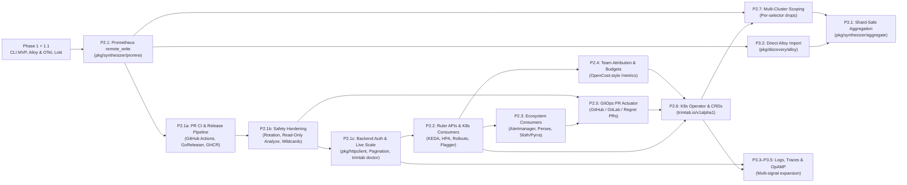

# Trimtab — Living Iterative Implementation Plan

> **Purpose:** Single evergreen implementation plan for Trimtab across all phases.
> **Progress Tracking:** Pair this plan with [docs/CHECKPOINT.md](CHECKPOINT.md) (compact live handoff & milestone status).
> **Read alongside:** [DESIGN.md](DESIGN.md) | [BACKENDS_AND_AUTH.md](BACKENDS_AND_AUTH.md) | [CHECKPOINT.md](CHECKPOINT.md) | [../AGENT.md](../AGENT.md) | [../agent_work.md](../agent_work.md)

---

## 1. Living Plan Convention & Iterative Workflow

1. **Single Plan File Rule:** **Never create per-phase plan files** (`PHASE2_PLAN.md`, `PHASE3_PLAN.md`, etc.). All future planning, scope refinements, and new phases MUST be appended to or updated in-place within this file (`docs/PLAN.md`), while [docs/CHECKPOINT.md](CHECKPOINT.md) stays the compact session checkpoint and handoff tracker.
2. **Iterative Development Loop (Per Sub-Phase):**
   1. **Refine:** Tighten the target sub-phase specification below (types, config/CRD schema, edge cases, verification plan) before coding.
   2. **Build & Test:** Implement the sub-phase alongside deterministic offline tests (`httptest.NewServer` / fixtures), golden tests (for synthesizers), and regression coverage for all 11 Safety Invariants in [AGENT.md](../AGENT.md).
   3. **Verify:** Run `go test -count=1 -race ./... && make verify` plus applicable `make demo*` targets.
   4. **Checkpoint:** Mark the completed sub-phase `[x]` in the Master Phase Tracker below and update [docs/CHECKPOINT.md](CHECKPOINT.md) (plus `AGENT.md` / `README.md` if CLI/config/targets changed).

---

## 2. Master Phase Tracker

| Phase | Sub-Phase | Name | Primary Packages | Status |
| :--- | :--- | :--- | :--- | :--- |
| **Phase 1** | **P1.0** | Metrics CLI MVP + Grafana Alloy Synthesizer | `cmd/trimtab/`, `pkg/config/`, `pkg/metrics/`, `pkg/state/`, `pkg/inventory/prometheus/`, `pkg/usage/*`, `pkg/engine/`, `pkg/synthesizer/alloy/`, `pkg/report/` | `[x]` Completed |
| **Phase 1.1** | **P1.1** | OTel Collector Synthesizer + Loki Query-Log Source | `pkg/synthesizer/otel/`, `pkg/usage/querylog/loki.go` | `[x]` Completed |
| **Phase 2** | **P2.1** | Prometheus `remote_write` Synthesizer | `pkg/synthesizer/relabel.go`, `pkg/synthesizer/promrw/` | `[x]` Completed |
| **Phase 2** | **P2.1a** | GitHub PR CI, Release Pipeline & Toolchain Hygiene | `.github/workflows/`, `.goreleaser.yaml`, `.golangci.yml`, `go.mod`, `Dockerfile` | `[ ]` Next |
| **Phase 2** | **P2.1b** | Safety-Critical Hardening | `pkg/state/`, `pkg/engine/`, `pkg/usage/querylog/`, `pkg/usage/promql/`, `cmd/trimtab/` | `[ ]` Planned |
| **Phase 2** | **P2.1c** | Unified Backend Auth, Live-Scale Hardening & `trimtab doctor` | `pkg/httpclient/`, `pkg/config/`, `pkg/inventory/prometheus/`, `pkg/usage/querylog/`, `pkg/usage/grafana/`, `pkg/synthesizer/alloy/`, `deploy/k8s/` | `[ ]` Planned |
| **Phase 2** | **P2.2** | Critical Infrastructure & Ruler Usage Sources | `pkg/usage/ruler/`, `pkg/usage/k8sconsumers/` | `[ ]` Planned |
| **Phase 2** | **P2.3** | Observability Ecosystem Static Consumers | `pkg/usage/alertmanager/`, `pkg/usage/perses/`, `pkg/usage/slo/` | `[ ]` Planned |
| **Phase 2** | **P2.4** | Per-Team Attribution & FinOps Exporter | `pkg/attribution/`, `pkg/exporter/` | `[ ]` Planned |
| **Phase 2** | **P2.5** | GitOps PR Actuator | `pkg/actuator/`, `pkg/actuator/gitops/` | `[ ]` Planned |
| **Phase 2** | **P2.6** | Kubernetes Operator & CRDs | `api/v1alpha1/`, `internal/controller/`, `cmd/trimtab-operator/` | `[ ]` Planned |
| **Phase 2** | **P2.7** | Multi-Cluster & Per-Selector Drop Scoping | `pkg/scope/`, `pkg/state/`, `pkg/engine/` | `[ ]` Planned |
| **Phase 3** | **P3.1** | Shard-Safe Aggregation Synthesizer | `pkg/synthesizer/aggregate/` | `[ ]` Future |
| **Phase 3** | **P3.2** | Direct Alloy Config Import Add-on | `pkg/discovery/alloy/` | `[ ]` Future |
| **Phase 3** | **P3.3** | Logs Signal Engine (Loki / LogQL) | `pkg/logs/` | `[ ]` Future |
| **Phase 3** | **P3.4** | Traces Signal Engine (Tail Sampling) | `pkg/traces/` | `[ ]` Future |
| **Phase 3** | **P3.5** | OpAMP Break-Glass Actuator | `pkg/actuator/opamp/` | `[ ]` Future |

### Dependency Graph



---

## 3. Safety-Invariant Continuity Matrix

All 11 Non-Negotiable Safety Invariants in [AGENT.md](../AGENT.md#L30-L49) MUST remain green across every iteration:

| Invariant | Cross-Phase Guardrail |
| :--- | :--- |
| **#1 Mandatory Query Log & Cold-Start** | P2.1b replaces span-only coverage with a trailing-window per-day `CoveredDates` map (`[now - minObservationWindow, now]`) and honors ledger `LastQueriedAt` + `LastBucketQueriedAt` so usage evidence survives log rotation; P2.2/P2.3 static scanners NEVER authorize drops without runtime query logs covering `>= minObservationWindow`. |
| **#2 Query Log Origin Classification** | Recording rules returned by Mimir/Thanos Ruler APIs (P2.2) feed ONLY `ResolveRecordingRuleDAG`, never live sinks. |
| **#3 Tranched Rollout + Sanity Ceiling** | P2.1 obeys `ActiveDrops`; P2.1b makes `trimtab analyze` observation-only (never activates tranches), requires explicit `trimtab synth --activate`, and adds `pending_confirmation -> soaking` confirmation from current active series (`--confirm-tranche` + optional `soakStartMode: "immediate"`); P2.5 opens one PR per active tranche; P2.6 respects `soakWindow` and `approvedTranche`. |
| **#4 Baseline Drift Circuit Breaker** | P2.1b upgrades static baselines (`Dashboards`, `GrafanaAlerts`, `PromRules`, etc.) to High-Water Marks (`max(prev, curr)`, lowered only on `--accept-baseline-shift`) and evaluates query-log volume via daily entry rate with `queryLogBaselineDriftThresholdPercent` (default `50%`); P2.1c ensures `401`/`403` and missing `*Env`/`*File` secrets fail closed; P2.2/P2.3 extend `state.BaselineCounts` and `engine.SourceCounts`. |
| **#5 Observation Window != Head Block** | P2.6 stores `StateLedger` persistently in ConfigMap/PVC so Pod restarts do not reset `first_seen_at`. |
| **#6 Default `neverDrop` & Wildcards** | P2.1b evaluates query-log wildcard detection per individual regex query expression (never unioning all queries by caller IP/Grafana); P2.1c auto-excludes `User-Agent: trimtab/` self-queries as `excluded-explorer`; wildcard detection & `excludeSources` apply uniformly to Perses (P2.3) and K8s consumers (P2.2). |
| **#7 Family Grouping & Capabilities** | `promrw` (P2.1) sets `CanDropHistogramBucketsOnly: true` via shared relabel helper; P2.7 refuses scoped OTel drops without `scopeAttributeMap`. |
| **#8 Full Label-Usage & Dead-Chain DAG** | P2.1b fixes PromQL scalar binary comparisons (`LHS.Type() == ValueTypeVector && RHS.Type() == ValueTypeVector`) so `sum by (job) (rate(x[5m]) > 0)` retains label precision; Alertmanager `group_by`/matchers/templates (P2.3) protect labels via `LabelUsage`; P2.5 dead-rule cleanup PRs use `yaml.Node` AST editing. |
| **#9 `DROP_DIMENSION` Advisory-Only (until P3.1)** | P2.4/P2.7 keep `DROP_DIMENSION` read-only; P3.1 introduces shard-safe aggregation only when collector shard identity is verified. |
| **#10 Forward-Only Regret Detection** | P2.1b keeps regret checks running during observation-only `analyze` against already-active drops without activating new tranches; P2.1c streaming query-log deduplication preserves `HitCount` and `LatestTS` for regret detection; P2.5 opens `[URGENT]` Regret Revert PRs immediately; P2.6 surfaces active regrets + `breakGlassUntil`. |
| **#11 Don't Over-Abstract Metrics** | `pkg/httpclient` (P2.1c), `pkg/actuator` (P2.5), and `pkg/state` remain signal-agnostic; `pkg/metrics`, `pkg/attribution`, `pkg/scope`, `pkg/logs` (P3.3), and `pkg/traces` (P3.4) stay idiomatic per signal. |

---

## 4. Phase 1 & Phase 1.1 — Foundation *(Completed)*

- **CLI & Core Engine:** `cmd/trimtab` (`analyze`, `synth`, `version`), `pkg/config`, `pkg/metrics`, `pkg/state` (atomic `.trimtab-state.json` ledger), `pkg/engine` (`family.go`, `dag.go`, `safety.go`, `regret.go`, `analyzer.go`), and `pkg/report` (`table`, `markdown`, `json`).
- **Discovery & Usage Sources:** Prometheus/Mimir HTTP + offline fixtures + `without` collapse (`pkg/inventory/prometheus`), PromQL AST walker (`pkg/usage/promql`), rotated JSONL / `prom-analytics-proxy` / Loki query logs (`pkg/usage/querylog`), Grafana dashboards + managed alerts (`pkg/usage/grafana`), and Prometheus rules YAML (`pkg/usage/promrules`).
- **Synthesizers:** Grafana Alloy `import.file` (`pkg/synthesizer/alloy`) and OpenTelemetry Collector `filter/trimtab` (`pkg/synthesizer/otel`) with golden tests + 10/10 Mandatory Safety Test Matrix (`pkg/engine/safety_matrix_test.go`).

---

## 5. Phase 2 — "OpenCost for Telemetry", K8s Operator, GitOps & Expanded Consumers

### P2.1 — Prometheus `remote_write` Synthesizer *(Completed)*

- **Goal:** Provide a drop-in Prometheus `remote_write[].write_relabel_configs` synthesizer (`DESIGN §7.3`) so standalone Prometheus, Prometheus Agent, and Prometheus Operator deployments can enforce trimtab drops without Alloy or OTel Collector.
- **Packages & Key Types:**
  - `pkg/synthesizer/relabel.go`: shared Prometheus relabel primitives (`DefaultMaxTermsPerRule = 40`, `SortActiveDrops`, `BuildRelabelRegexTerm`, `ChunkRelabelRegexes`, `CollectRelabelTerms`) shared identically by `pkg/synthesizer/alloy` and `pkg/synthesizer/promrw`.
  - `pkg/synthesizer/promrw/promrw.go`: `Synthesizer`, `Mode` (`relabel_configs`, `remote_write`, `prometheus_operator_patch`), `Options`.
    - `relabel_configs` (default): emits top-level `write_relabel_configs` (`write_relabel_configs: []` on 0 drops) in `trimtab-remote-write.yaml`.
    - `remote_write`: emits `remote_write:` entry with `name`, `url`, and `write_relabel_configs`.
    - `prometheus_operator_patch`: emits camelCase `monitoring.coreos.com/v1` `Prometheus` / `PrometheusAgent` strategic-merge patch (`spec.remoteWrite[].writeRelabelConfigs[].sourceLabels`) in `trimtab-prometheus-operator-patch.yaml`.
    - `Capabilities()`: `CanDropFamily: true`, `CanDropHistogramBucketsOnly: true`.
- **Config Schema Additions (`pkg/config/config.go`):**
  - `synthesizer.target` accepts `"alloy"`, `"otel"`, `"promrw"`, `"prometheus-remote-write"`.
  - Optional `synthesizer.promRW` block (`mode`, `remoteWriteName`, `remoteWriteURL`, `operatorKind`, `operatorName`, `operatorNamespace`, `maxTermsPerRule`).
- **CLI, Report & Demo:**
  - `trimtab synth --target promrw` / `trimtab analyze --target promrw`.
  - Report footer label `"Prometheus remote_write rules"` in `pkg/report/report.go`.
  - Demo config `examples/demo/trimtab-promrw.yaml`, human-owned insertion example `examples/demo/prometheus-remote-write.yaml.example`, `make demo-promrw`, and `Tiltfile` `synth-promrw-preview`.
- **Verification & Exit Criteria:**
  - Byte-for-byte Alloy golden test parity after extracting `pkg/synthesizer/relabel.go`.
  - 5 `promrw` golden tests (`normal`, `noop`, `bucket_only`, `remote_write`, `operator_patch`).
  - Real `github.com/prometheus/prometheus/model/relabel` validation (`cfg.Validate(model.UTF8Validation)`) and runtime `relabel.ProcessBuilder(...)` execution tests proving family drops, bucket-only drops, summary drops, dotted UTF-8 names, and multi-rule chunking behave accurately.
  - CLI E2E test + `make verify && make demo && make demo-otel && make demo-promrw` green.

---

### P2.1a — GitHub PR CI, Release Pipeline & Toolchain Hygiene *(Next Build Target)*

- **Goal:** Establish automated PR quality gates and reproducible GitHub Releases + multi-arch container image publishing first, so every subsequent Phase 2 PR (starting with `P2.1b`) is CI-verified and any tagged build can be pulled directly into Kubernetes clusters.
- **Scope & Deliverables:**
  1. **Toolchain Hygiene (`go.mod`):**
     - Change `go 1.27.3` to `go 1.27` without pinning a patch `toolchain` directive so contributors on any `1.27.x` or newer toolchain build locally without forced downloads.
  2. **PR & Main Branch CI (`.github/workflows/ci.yml`, `.golangci.yml`):**
     - Triggered on `pull_request` and `push` to `main` (with concurrency cancel-in-progress).
     - Runs `go test -count=1 -race ./...`, `golangci-lint` (lean `.golangci.yml` ruleset), `go build ./cmd/trimtab`, golden test verification, offline demo smoke suite (`make demo && make demo-otel && make demo-promrw`), and a non-pushing container build check (`docker buildx build`) so `Dockerfile` stays green on every PR.
  3. **Tag-Triggered Release CI (`.github/workflows/release.yml`, `.goreleaser.yaml`, `Dockerfile`):**
     - Triggered on semver tags (`v*.*.*`, supporting pre-releases such as `v0.2.0-rc.1`).
     - Runs the full `go test -count=1 -race ./...` pre-release gate before publishing any artifacts.
     - Cross-compiles reproducible `CGO_ENABLED=0` static binaries (`-trimpath -ldflags="-s -w -X main.version={{.Version}} -X main.commit={{.ShortCommit}}"`, matching existing `version`/`commit` variables in `cmd/trimtab/main.go`) for `linux` and `darwin` (`amd64`, `arm64`), publishing archives, `checksums.txt`, SPDX SBOM, and auto-generated release notes to GitHub Releases.
     - Updates `Dockerfile` with `ARG TARGETARCH`, `ARG VERSION=dev`, `ARG COMMIT=local` (setting `GOARCH=${TARGETARCH}` and `-ldflags` version/commit injection) and publishes multi-arch (`linux/amd64`, `linux/arm64`) OCI images to GHCR (`ghcr.io/<owner>/trimtab:<tag>`, plus `:latest` on stable non-prerelease tags) using `GITHUB_TOKEN` (`packages: write`, `contents: write`, `id-token: write`, `attestations: write`).
     - Emits GitHub build provenance attestations (`actions/attest-build-provenance`) for both release archives and OCI container images.
- **Verification & Exit Criteria:**
  - `goreleaser check` and `goreleaser release --snapshot --clean` pass locally.
  - `docker buildx build --platform linux/amd64,linux/arm64 --build-arg VERSION=v0.1.0-test --build-arg COMMIT=local .` builds cleanly and `trimtab version` inside the container prints the injected version and commit.
  - PR CI workflow passes on GitHub (`go test -race`, `golangci-lint`, demos, container build); tag push (or first `v0.1.0` release tag) publishes GitHub Release + GHCR multi-arch image + `checksums.txt` + build provenance attestation.

---

### P2.1b — Safety-Critical Hardening *(Planned)*

- **Goal:** Eliminate three safety-critical production bugs (usage evidence lost on log rotation, `analyze` silently activating tranches, and caller-grouped wildcard detection flagging shared dashboard servers), restore PromQL label precision on scalar binary comparisons, and prevent gradual baseline bleed-down before building new Phase 2 consumers.
- **Scope & Exact Changes:**
  1. **Log-Rotation Usage Survival & Trailing-Window Coverage Bitmap (`pkg/state/ledger.go`, `pkg/usage/querylog/reader.go`, `pkg/engine/analyzer.go`):**
     - Add `LastBucketQueriedAt time.Time` to `state.SeenFamily` alongside `LastQueriedAt` so classic histogram `_bucket` usage also survives rotation independently of `_sum`/`_count` queries.
     - Add `CoveredDates map[string]int` (UTC `YYYY-MM-DD` → entry count) to `state.QueryLogCoverage` and `ObservedDates map[string]int` on `querylog.Result`.
     - Compute `CoveredDays` strictly from unique covered UTC calendar days within `[now - minObservationWindow, now]` (trailing window, not all-time span—a multi-week logging stall inside the window keeps Trimtab in Report-Only mode). Keep backward-compatible loading for v1 ledgers that lack `CoveredDates`.
     - Treat a family as live if `fu.IsLive()` OR `max(fu.LastLiveQueryAt, ledger.SeenFamilies[fam].LastQueriedAt)` falls within `[now - minObservationWindow, now]`; treat histogram `_bucket` as live if `fu.UsedBuckets` OR `ledger.SeenFamilies[fam].LastBucketQueriedAt` falls within `[now - minObservationWindow, now]`.
  2. **Observation-Only `analyze`, Explicit Activation & Confirmed Soak Lifecycle (`pkg/engine/analyzer.go`, `pkg/state/ledger.go`, `pkg/config/config.go`, `cmd/trimtab/main.go`, `pkg/report/report.go`, `examples/demo/`, `Makefile`):**
     - `trimtab analyze`: observation, reporting, and regret detection against already-active drops only; persists passive observation updates (`seen_families`, `covered_dates`, baseline high-water marks, regret events) unless `--no-state-write`, **never activates new tranches or adds entries to `ActiveDrops`**.
     - `trimtab synth`: synthesizes collector artifact for currently active drops (or `--preview-next` without mutating tranches).
     - `trimtab synth --activate`: explicitly activates the next eligible tranche into `pending_confirmation` (recording `ActivatedAt`), and writes the synthesized artifact.
     - Tranche lifecycle: `pending_confirmation` → `soaking` (`ConfirmedAt`, `SoakUntil = ConfirmedAt + soakWindow`) → `soaked` | `blocked_regret`.
     - Auto-confirm transition to `soaking` when dropped targets' current live series reach `0` (checking `*_bucket` specifically for `ActionDropHistogramBuckets`, or `<= policy.confirmationMaxRemainingPercent`, default `0%`), emit a warning if a tranche stays `pending_confirmation` `> 48h`, and support explicit `--confirm-tranche` plus `policy.soakStartMode: "observed" | "immediate"` (default `"observed"`; `"immediate"` available for single-snapshot demos/CI).
     - Update `examples/demo/` query logs to cover 30 distinct UTC calendar days and align `Makefile` demo targets and `cmd/trimtab/main_test.go`.
  3. **Per-Expression Query-Log Wildcard Detection (`pkg/engine/analyzer.go`, `pkg/usage/querylog/reader.go`):**
     - Keep per-dashboard grouping for static `OriginGrafanaDashboard` (`grafana-dashboard:<uid>`).
     - For `OriginAPIUser` query logs, evaluate wildcard thresholds (`> policy.WildcardThresholdPercent`) **per individual regex/broad query expression** (`ref.IsRegex == true`), never by unioning all queries from a caller IP or dashboard server `User-Agent`. Recommend exclusion via `query_regex` (or `dashboard_uid` when present in headers).
  4. **PromQL Scalar Binary Label Precision (`pkg/usage/promql/extractor.go`):**
     - In `walkBinary`, apply `n.VectorMatching` rules **only** when `n.LHS.Type() == parser.ValueTypeVector && n.RHS.Type() == parser.ValueTypeVector`, restoring exact label preservation on expressions like `sum by (job) (rate(x[5m]) > 0)` and `count by (job) (up == 0)`.
  5. **High-Water-Mark Static Baselines & Daily Query-Log Rate (`pkg/engine/safety.go`, `pkg/state/ledger.go`, `pkg/config/config.go`):**
     - Static source baselines (`Dashboards`, `GrafanaAlerts`, `PromRules`, etc.) update monotonically (`max(prev, curr)`) and only decrease when `--accept-baseline-shift` is explicitly passed, preventing slow `<20%`/run bleed-down.
     - Query-log baseline drift compares daily entry rates (derived from `CoveredDates`) against a rolling baseline with a separate configurable `policy.queryLogBaselineDriftThresholdPercent` (default `50.0`) so weekend traffic dips or rotation timing do not false-abort while broken log pipelines still trip.
- **Verification & Exit Criteria:**
  - Expand Mandatory Safety Test Matrix (`pkg/engine/safety_matrix_test.go`) from 10 to **13 invariants**:
    - `#11` **Log-Rotation Survival & Trailing Bitmap:** Day-10 family & `_bucket` query rotated off disk stay protected at Day-30 via ledger timestamps; a 3-week middle gap in `CoveredDates` keeps Trimtab in Report-Only mode.
    - `#12` **Observation-Only `analyze` & Confirmed Soak:** `analyze` never activates tranches; `synth --activate` enters `pending_confirmation`; soak starts only after dropped series disappear from current inventory (or `--confirm-tranche`).
    - `#13` **Per-Expression Query-Log Wildcards:** Shared dashboard server/IP issuing diverse queries across `>50%` of inventory is NOT flagged as a wildcard protector, while a single `{__name__=~".+"}` query IS flagged.
  - Unit tests for scalar binary label precision (`pkg/usage/promql/extractor_test.go`) and baseline high-water-mark bleed-down resistance (`pkg/engine/safety_matrix_test.go`).
  - `go test -count=1 -race ./... && make verify && make demo && make demo-otel && make demo-promrw` green.

---

### P2.1c — Unified Backend Auth (`pkg/httpclient`), Live-Scale Hardening & `trimtab doctor` *(Planned)*

- **Goal:** Implement the lean, vendor-neutral backend connectivity and authentication architecture specified in [BACKENDS_AND_AUTH.md](BACKENDS_AND_AUTH.md), eliminate live-cluster scale/truncation gaps across Prometheus/Mimir, Loki, and Grafana APIs, add Helm/GitOps-ready Alloy output modes, and provide `trimtab doctor` pre-flight verification before expanding Phase 2 consumers.
- **Packages & Key Types:**
  - `pkg/config/config.go`:
    - Add reusable `HTTPAuthConfig` (`BearerToken`, `BearerTokenEnv`, `BearerTokenFile`, `BasicAuth` with `Username`/`Env`/`File` + `Password`/`Env`/`File`, `TLS` with `CAFile`/`CertFile`/`KeyFile`/`ServerName`/`InsecureSkipVerify`), plus `TenantID` (`X-Scope-OrgID`), `Headers`, `HeadersEnv`, and `HeadersFile` across `InventoryConfig`, `LokiQueryLogConfig`, `GrafanaConfig`, and upcoming `RulerConfig` / `PersesConfig`.
    - Add `InventoryConfig.Selector` (`match[]`), `InventoryConfig.TSDBLimit` (default `10000`), `InventoryConfig.ProbeFirstSeen`, `LokiQueryLogConfig.MaxPagesPerChunk`, `GrafanaConfig.AlertAPI` (`"provisioning" | "ruler"`), and `SynthesizerConfig.Alloy` (`Mode: "module" | "relabel_rules" | "configmap"`, `ConfigMapName`, `ConfigMapNamespace`, `ConfigMapKey`, `MaxTermsPerRule`).
  - `pkg/httpclient/`:
    - Shared Go-stdlib HTTP client factory (`New(cfg, userAgent)`) implementing No Auth, HTTP Basic Auth, Bearer Token, Custom Header Auth, `X-Scope-OrgID`, and TLS/mTLS (`crypto/tls`, `crypto/x509`).
    - Enforces fail-closed config validation (mutually exclusive primary auth modes; missing/empty `*Env` or `*File` errors fast), short-TTL `*File` secret reload, secret redaction in errors/logs/reports, bounded retries on `429`/`502`/`503`/`504`, no retry on `401`/`403`, and `User-Agent: trimtab/<version>` stamping.
    - Migrate `pkg/inventory/prometheus`, `pkg/usage/querylog/loki.go`, and `pkg/usage/grafana` onto `pkg/httpclient`, preserving full backward compatibility with existing `trimtab.yaml` fields.
  - `pkg/inventory/prometheus/client.go`:
    - Pass `?limit=<tsdbLimit>` (default `10000`) to `/api/v1/status/tsdb` to prevent silent top-10 truncation.
    - Scope `/api/v1/label/__name__/values`, `/api/v1/labels`, and `without`-collapse queries by `InventoryConfig.Selector` when configured, with batched `count by (__name__) ({<selector>, __name__=~"..."})` fallback for exact per-cluster series counts in shared stores, plus optional early-window `ProbeFirstSeen`.
  - `pkg/usage/querylog/loki.go` & `reader.go`:
    - Add forward pagination within every Loki chunk (`maxTS + 1ns` continuation + tie-guard warning/fail-closed error) so high-volume query logs are never silently truncated at `limit`.
    - Parse Mimir `param_query="..."` and `param_match[]="..."` in logfmt/JSON logs alongside `query="..."`.
    - Add memory-bounded streaming deduplication by `(query, origin, caller, ruleGroup)` retaining `HitCount`, `EarliestTS`, and `LatestTS` (preserving exact Regret Detection fidelity across 30-day lookbacks).
    - Auto-exclude `trimtab/` `User-Agent` callers as `OriginExcludedExplorer` so Trimtab's own inventory and `without`-collapse queries never pollute live usage or trigger false Regret.
  - `pkg/usage/grafana/scanner.go`:
    - Filter out non-Prometheus panel/target datasources (ignoring LogQL/TraceQL queries on multi-signal dashboards), paginate `/api/search?page=...`, and support optional `/api/ruler/grafana/api/v1/rules` alert reading.
  - `pkg/synthesizer/alloy/alloy.go`:
    - Support `mode: "module"` (default `import.file`), `"relabel_rules"` (bare Alloy `rule { ... }` blocks for Helm `values.yaml`), and `"configmap"` (Kubernetes `v1/ConfigMap` manifest) sharing `pkg/synthesizer/relabel.go`.
  - `cmd/trimtab/main.go` & `deploy/k8s/`:
    - Add `trimtab doctor --config <path>` pre-flight command verifying reachability, TLS, auth, `X-Scope-OrgID`, and read-only permissions across all configured backends without mutating state.
    - Add read-only Kubernetes `CronJob` + PVC ledger + Secret `envFrom` reference manifests in `deploy/k8s/`.
- **Verification & Exit Criteria:**
  - `httptest.NewServer` and `httptest.NewTLSServer` tests for `pkg/httpclient` (Basic, Bearer, Custom Headers `*Env`/`*File` hot-reload, mTLS, `X-Scope-OrgID`, mutual exclusion, missing-secret fail-closed, secret redaction, `429`/`503` retries, `401`/`403` no-retry, `User-Agent: trimtab/` auto-exclusion).
  - Live-scale tests: `/status/tsdb?limit`, `selector` + batched `count by (__name__)`, multi-page Loki pagination (`limit=2` over 5 lines) + `param_query="..."` + streaming dedup regret test, Grafana multi-datasource filtering + search pagination, Alloy 3-mode golden tests, and `trimtab doctor` CLI E2E test.

---

### P2.2 — Critical Infrastructure & Ruler Usage Sources *(Planned)*

- **Goal:** Close the highest-severity static visibility gaps called out in `DESIGN §3.2`: Mimir/Thanos Ruler APIs and Kubernetes autoscaling/progressive-delivery consumers whose metrics must never be mistakenly flagged unused if query logs have gaps or during cold start.
- **Packages & Key Types:**
  - `pkg/metrics/types.go`: add `UsageOrigin` constants (`OriginRulerAlert`, `OriginKEDA`, `OriginPromAdapter`, `OriginArgoRollouts`, `OriginFlagger`); all return `true` from `IsLiveSink()`.
  - `pkg/usage/ruler/`: HTTP scanner built on `pkg/httpclient` + `config.HTTPAuthConfig` (`P2.1c`) supporting:
    - Cortex/Mimir Ruler (`/prometheus/config/v1/rules`, optional `X-Scope-OrgID` header, multi-namespace YAML rule-group response).
    - Prometheus/Thanos Ruler (`/api/v1/rules`, JSON groups response).
    - Emits `AlertRefs` (`OriginRulerAlert`) and `RecordingRules` (`promrules.RecordingRule`, fed directly into existing `engine.ResolveRecordingRuleDAG`).
  - `pkg/usage/k8sconsumers/`: multi-document YAML glob/directory scanner (plus a small `ManifestSource` interface so P2.6's operator can feed live cluster objects into the same parser) covering:
    - **KEDA** `ScaledObject` / `ScaledJob` (`keda.sh/v1alpha1`): extracts `spec.triggers[type=prometheus].metadata.query` (sanitizing `{{...}}` template tokens before `promql.Extract`).
    - **`prometheus-adapter`** ConfigMap (`rules.yaml` / `adapter-config.yaml`): extracts `seriesQuery`, `resources.overrides`, and `metricsQuery` (substituting `<<.Series>>`, `<<.LabelMatchers>>`, `<<.GroupBy>>` safely before `promql.Extract`).
    - **Argo Rollouts** `AnalysisTemplate` / `ClusterAnalysisTemplate` (`argoproj.io/v1alpha1`): extracts `spec.metrics[].provider.prometheus.query` (substituting `{{args.*}}` placeholders).
    - **Flagger** `MetricTemplate` / `Canary` (`flagger.app/v1beta1`): extracts `spec.query` (substituting `{{ namespace }}`, `{{ target }}`, `{{ interval }}`).
- **Config & State Additions:**
  - `usage.rulers[]`: `{ type: "mimir"|"prometheus"|"thanos", url, tenantID, bearerToken, headers, timeout }`.
  - `usage.k8sConsumers`: `{ globs: []string, enableKEDA: *bool, enablePromAdapter: *bool, enableArgoRollouts: *bool, enableFlagger: *bool }`.
  - `state.BaselineCounts` + `engine.SourceCounts`: add `*int` fields `RulerRules`, `KEDATriggers`, `PromAdapterRules`, `RolloutTemplates`, `FlaggerTemplates` checked by `engine.CheckBaselineDrift` (Invariant #4, inheriting HWM monotonic baseline tracking from `P2.1b`).
- **Verification & Exit Criteria:**
  - `httptest.NewServer` tests for Mimir YAML and Prometheus/Thanos JSON ruler APIs (including HTTP error fail-closed & baseline drift abort).
  - Fixture tests for KEDA, `prometheus-adapter`, Argo Rollouts, and Flagger verifying PromQL metric names + labels (`by`/`without`/matchers) are marked live-used.
  - Safety Matrix regression check confirming static consumers alone without query logs still keep Trimtab in Report-Only mode (Invariant #1).

---

### P2.3 — Observability Ecosystem Static Consumers

- **Goal:** Protect labels needed for alert routing/templating and ingest usage from Perses dashboards and Sloth/Pyrra SLO definitions.
- **Packages & Key Types:**
  - `pkg/usage/alertmanager/`: parses Alertmanager YAML (`route` tree including nested `routes`, `match`, `match_re`, `matchers` string syntax `foo=~"bar"`, `group_by`, `inhibit_rules`, and receiver Go templates `.CommonLabels.<lbl>` / `.GroupLabels.<lbl>`).
    - **Semantics note:** Alertmanager does not reference metric names; it references **alert labels** carried forward from alerting rules. `engine.Analyze` merges Alertmanager-referenced labels onto every metric family referenced by alerting rules (`OriginPromAlert`, `OriginGrafanaAlert`, `OriginRulerAlert`) so `LabelUsage` never marks routing/grouping labels unused (Invariant #8).
  - `pkg/usage/perses/`: scans local Perses dashboard JSON/YAML directories and Perses REST API (`/api/v1/projects`, `/api/v1/projects/{project}/dashboards`), extracting `PrometheusTimeSeriesQuery` PromQL + `seriesNameFormat` legend templates and `PrometheusLabelValuesVariable` / `PrometheusPromQLVariable` definitions into `OriginPersesDashboard` (`IsLiveSink() == true`).
  - `pkg/usage/slo/`: scans Sloth (`sloth.slok.dev/v1` `PrometheusServiceLevel`, `rawInterval`/`window` Go-template substitution) and Pyrra (`pyrra.dev/v1alpha1` `ServiceLevelObjective`, `indicator.ratio`/`latency`/`bool_gauge`) YAML specs into `OriginSLO` (`IsLiveSink() == true`).
- **Config & State Additions:**
  - `usage.alertmanager`: `{ configPaths: []string, url, bearerToken, timeout }`.
  - `usage.perses`: `{ url, apiKey, headers, dashboardsDir, projects: []string, timeout }`.
  - `usage.slo`: `{ globs: []string }`.
  - `state.BaselineCounts` + `engine.SourceCounts`: add `AlertmanagerMatchers`, `PersesDashboards`, `SLOs`.
- **Verification & Exit Criteria:**
  - Alertmanager test proving a label appearing ONLY in `group_by` or `route.matchers` is protected on alerted metrics and omitted from `LabelCollapseAdvisories`.
  - Perses local-dir + `httptest.NewServer` API tests + wildcard protector test for catch-all Perses dashboards.
  - Sloth & Pyrra fixture tests verifying SLI error/total/latency bucket metrics and grouping labels are protected.

---

### P2.4 — Per-Team Attribution & "OpenCost for Telemetry" FinOps Exporter

- **Goal:** Answer *"which team owns these active/droppable series and how much do they cost?"*, evaluate per-team budgets, and expose OpenCost-compatible Prometheus metrics (`DESIGN §2, §8`).
- **Packages & Key Types:**
  - `pkg/attribution/`:
    - `TeamMapping`, `CostModel`, `TeamSummary`, `BudgetStatus`, `AttributionReport`.
    - **Series-weighted attribution:** Using Prometheus instant query `sum by (<attribution_labels>) (__name__=~"...")` (bounded/batched, with offline fixture fallback via `SampleLabelSets` in `SeriesStats`) to apportion each family's active and droppable series accurately across teams instead of assigning an entire shared metric to one team.
    - **Deterministic Resolver Chain** (first match wins):
      1. Metric label rule (ordered list e.g. `team`, `owner`, `app_team` with optional regex map).
      2. Kubernetes `namespace` / workload (`service`, `app_kubernetes_io_name`) static mapping or regex rule.
      3. Backstage `catalog-info.yaml` loader (`metadata.name` / `metadata.annotations["prometheus.io/..."]` -> `spec.owner`, stripping `group:`/`team:` prefixes deterministically).
      4. Fallback bucket: `"unattributed"` (explicitly reported so platform teams see un-tagged telemetry).
    - **Budget Evaluation:** Evaluates configured `Budgets` (`team`, `maxActiveSeries`, `maxMonthlyCostUSD`, `warnThresholdPercent`) -> `WithinBudget`, `Warning`, `Exceeded`.
    - **Pricing:** `costPerThousandSeriesMonthlyUSD` (default `0`: dollar metrics/columns only render when pricing > 0 so Trimtab never fabricates vendor billing rates).
  - `pkg/metrics/types.go`: add optional `Attribution *AttributionReport` field on `AuditReport` (rendered in `pkg/report` table/markdown/json when present).
  - `pkg/exporter/`: `Server` wrapping `prometheus/client_golang` (`prometheus.NewRegistry()`, avoiding global registry pollution) exposed via `trimtab serve --config ... --listen :9190 --interval 15m` with `/metrics`, `/healthz`, `/readyz` and background scrape loop (strictly out of the data path).
    - Exported metrics:
      - `trimtab_team_active_series{team,tenant}`
      - `trimtab_team_droppable_series{team,tenant}`
      - `trimtab_team_synthesized_drop_series{team,tenant}`
      - `trimtab_team_monthly_cost_dollars{team,tenant}`
      - `trimtab_team_potential_monthly_savings_dollars{team,tenant}`
      - `trimtab_team_budget_utilization_ratio{team,tenant}`
      - `trimtab_query_log_coverage_days{tenant}`
      - `trimtab_safety_gate_blocked{tenant,reason}`
      - `trimtab_active_tranche{tenant}`
      - `trimtab_regret_events_total{tenant}`
- **Verification & Exit Criteria:**
  - Resolver chain unit tests (priority precedence, Backstage YAML parsing, `"unattributed"` fallback, budget warning/exceeded thresholds).
  - `httptest` scrape test parsing Prometheus text exposition output from `pkg/exporter` via `expfmt` / `dto` and asserting all gauge/counter values match `AuditReport`.
  - Clean `trimtab serve` shutdown on `SIGINT`/`SIGTERM`.

---

### P2.5 — GitOps PR Actuator

- **Goal:** Automate safe, auditable GitOps pull/merge requests for tranched drops, dead recording-rule cleanup, and urgent Regret Reverts (`DESIGN §2, §3.10, §5`).
- **Packages & Key Types:**
  - `pkg/actuator/actuator.go`: signal-agnostic interface (`DESIGN §5`):
    ```go
    type ActuationRequest struct {
        Report          *metrics.AuditReport
        Artifact        *synthesizer.GeneratedArtifact
        RuleEdits       []RuleDeletion
        StateFileUpdate []byte
    }
    type ActuationResult struct {
        Mode       string
        PRURL      string
        PRNumber   int
        Branch     string
        ActionType string // "drop_tranche", "regret_revert", "dead_rule_cleanup", "noop"
    }
    type Actuator interface {
        Name() string
        Actuate(ctx context.Context, req ActuationRequest) (*ActuationResult, error)
    }
    ```
  - `pkg/actuator/gitops/`:
    - `GitProvider` interface (`EnsureBranch`, `GetFile`, `UpsertFiles`, `OpenOrUpdatePR`) with three implementations:
      1. `github` (GitHub REST API v3; token via env var e.g. `GITHUB_TOKEN`, never stored in plaintext config).
      2. `gitlab` (GitLab REST API v4; token via env var e.g. `GITLAB_TOKEN`).
      3. `local` / `dryrun` (writes unified diffs & PR markdown preview to disk/stdout for offline testing & CI).
    - **Workflow 1 — Regret Revert PR (Highest Priority):** When `len(Report.Regrets) > 0`, immediately opens/updates `trimtab/regret-revert-<name>` titled `[URGENT][Trimtab] Revert drop for <families> (regret detected)`, committing the re-synthesized artifact (regretted metrics removed) + updated state ledger (or `neverDrop` override), with the exact triggering `api-user` query, timestamp, and hit count in the PR body.
    - **Workflow 2 — Tranched Drop PR:** When `!Report.Safety.ReportOnly && !Report.Safety.Blocked` and `Artifact.DroppedFamilies > 0`, opens/updates `trimtab/tranche-<N>-<name>` writing `Artifact.Content` to the target git path and setting PR body from `report.Render(rep, report.FormatMarkdown)`. Refuses to open drop PRs in Report-Only or Blocked states. Integrates cleanly with `P2.1b`'s `pending_confirmation -> soaking` confirmation lifecycle so the soak timer starts only once the merged PR takes effect in the metrics store.
    - **Workflow 3 — Dead Recording-Rule Cleanup PR (Opt-in):** When `actuator.cleanupDeadRules: true`, parses target rule YAML files into `gopkg.in/yaml.v3` `yaml.Node` trees and removes only exact `(group, ruleName)` nodes identified in `Report.DeadRecordingRules`, preserving surrounding comments, anchors, and formatting, and highlighting any `HasOrVectorZero` rules in the PR description.
- **CLI Additions (`cmd/trimtab/main.go`):**
  - `trimtab actuate --config trimtab.yaml [--dry-run]`: runs `Analyze` + `Synthesize` + `Actuator.Actuate`.
- **Verification & Exit Criteria:**
  - `httptest.NewServer` mock tests for GitHub and GitLab providers (idempotent branch/commit/PR update, auth headers, non-2xx error handling).
  - YAML `yaml.Node` comment-preserving deletion tests (single rule deleted from multi-rule group without mangling sibling rules/comments; empty group safely handled).
  - Regret Revert PR integration test verifying `[URGENT]` PR fires even if tranche rollout is blocked.

---

### P2.6 — Kubernetes Operator & CRDs

- **Goal:** Provide Kubernetes-native lifecycle management, scheduled audits, persistent in-cluster ledger storage, `TelemetryBudget` status enforcement, and emergency `breakGlassUntil` overrides (`DESIGN §8`).
- **Packages & Layout:**
  - `api/v1alpha1/`: `groupversion_info.go` (`trimtab.io/v1alpha1`) and CRD Go types:
    - `TelemetryAuditPolicy`: `spec` mirrors `config.Config` (`inventory`, `usage`, `policy`, `synthesizer`, `attribution`, `actuator`, `scheduleInterval`, `ledgerRef`), plus `inClusterDiscovery` toggles for `ScaledObject`, `AnalysisTemplate`, `PrometheusRule`; `status` tracks `lastAuditTime`, `queryLogCoveredDays`, `activeTranche`, `totalTranches`, `safetyBlocked`, `conditions`.
    - `TelemetryBudget`: `spec` (`team`, `policyRef`, `maxActiveSeries`, `maxMonthlyCostUSD`, `warnThresholdPercent`); `status` (`activeSeries`, `droppableSeries`, `monthlyCostUSD`, `utilizationPercent`, `state: WithinBudget|Warning|Exceeded`, `conditions`).
    - `TelemetryRecommendation`: materialized by the controller per policy (`spec.approvalMode: auto|manual`, `spec.approvedTranche`, `spec.breakGlassUntil`, `spec.acknowledgedBaselineShift`); `status` mirrors `ActiveDrops`, `ProjectedDrops`, `DeadRecordingRules`, `LabelCollapseAdvisories`, `Regrets`, and synthesized ConfigMap/Secret reference.
  - `internal/controller/`: `controller-runtime` reconcilers for all 3 CRDs + ConfigMap/PVC `StateLedger` backend (`pkg/state` `Store` interface implemented for file, ConfigMap, and in-memory).
  - `cmd/trimtab-operator/`: separate operator binary entrypoint so `cmd/trimtab` CLI stays fast and dependency-light for non-K8s users; includes `/metrics` (merged with `pkg/exporter`), `/healthz`, `/readyz`, and leader election.
  - `deploy/operator/`: generated CRD YAML (`controller-gen`), RBAC (`ClusterRole` read-only on `ScaledObject`/`PrometheusRule`/`AnalysisTemplate`/`Canary` + read/write on Trimtab CRDs and output ConfigMaps), and `Deployment`. Extend `.github/workflows/release.yml` and `.goreleaser.yaml` from `P2.1a` to publish the `trimtab-operator` multi-arch container image and CRD/Helm release bundle alongside the CLI.
  - `Tiltfile` & `scripts/local-k8s.sh`: add optional operator dev deployment profile in Kind.
- **Safety Guarantees:**
  - **`breakGlassUntil`:** When `now < recommendation.Spec.BreakGlassUntil`, the controller immediately sets `ReportOnly`/override mode and writes a zero-drop pass-through/no-op artifact to the output ConfigMap (and triggers Regret/PR if GitOps enabled), **without** permanently polluting `neverDrop`; once `BreakGlassUntil` expires, normal state resumes.
- **Verification & Exit Criteria:**
  - `envtest` (or mocked `sigs.k8s.io/controller-runtime/pkg/client/fake`) reconciler tests for: initial Report-Only cold-start status, tranche advancement after `soakWindow`, manual approval gate, `breakGlassUntil` immediate pass-through, and `TelemetryBudget` status transitions.
  - Kind cluster smoke test applying sample CRs and verifying generated ConfigMap artifact.

---

### P2.7 — Multi-Cluster & Per-Selector Drop Scoping

- **Goal:** Allow Trimtab to drop a metric only in specific clusters/environments (e.g., drop `debug_cache_hits_total` in `cluster="staging"` while keeping it in `cluster="prod"`) without breaking single-tenant safety guarantees.
- **Packages & Key Types:**
  - `pkg/scope/`:
    - `ScopeKey` (canonical sorted `label=value` tuple, e.g., `cluster=staging,env=dev`, or `""` for global scope).
    - `ExtractQueryScopes(expr parser.Expr, scopeLabels []string)`: walks PromQL `VectorSelector` matchers (`=`, `!=`, `=~`, `!~`) for configured `policy.scopeLabels`.
    - **Global Query Safety Invariant (Hard Requirement):** If a live query, dashboard, alert, or K8s consumer omits a matcher on a `scopeLabel` (an **unscoped query**), or uses a regex matcher that cannot be bounded, it MUST protect the metric family across **ALL scopes** (never drop in any scope on an unverified unscoped query).
  - `pkg/state/ledger.go`: bump `CurrentSchemaVersion = 2` with automatic, lossless migration from v1 (`SeenFamilies` / `ActiveDrops` migrate under global scope `""` on `state.Load`).
  - `pkg/engine/`: scope-aware `UsageIndex` + per-(family, scope) tranche planning and regret detection. If an unscoped `api-user` query hits a metric dropped in *any* scope, Regret fires and restores all dropped scopes for that family.
  - `pkg/synthesizer/` (`alloy`, `promrw`, `otel`):
    - **Alloy & Prometheus `remote_write`:** Emit multi-label relabel rules when drops are scoped, e.g. `source_labels = ["__name__", "cluster"]`, `separator = ";"`, `regex = "(metric_a|metric_b);staging"`, `action = "drop"`.
    - **OTel Collector:** Emit scoped OTTL predicates (`'name == "metric_a" and resource.attributes["k8s.cluster.name"] == "staging"'`) **ONLY** when an explicit `synthesizer.otel.scopeAttributeMap` (`cluster -> resource.attributes["..."]` or `attributes["..."]`) is configured; otherwise refuse scoped OTel drop with a capability advisory warning (preserving Invariant #7's zero-guessing rule).
- **Verification & Exit Criteria:**
  - Safety Matrix tests for: (1) scoped query protects only `prod` and allows dropping `staging`, (2) unscoped query protects BOTH `prod` and `staging`, (3) regex matcher `{cluster=~"prod-.*"}` protects matching scopes conservatively, (4) v1 -> v2 ledger migration preserves `first_seen_at`, `active_drops`, and `pinned_never_drop`, (5) real Prometheus `relabel.ProcessBuilder` test confirming `source_labels: [__name__, cluster]` drops `metric_a` in `staging` while keeping `metric_a` in `prod`.

---

## 6. Phase 3 — Shard-Safe Aggregation, Multi-Signal & OpAMP *(Future Roadmap)*

*(Refine each sub-phase here in `docs/PLAN.md` before building; never create a separate `PHASE3_PLAN.md`.)*

### P3.1 — Shard-Safe Aggregation Synthesizer (`pkg/synthesizer/aggregate/`)

- Graduate `DROP_DIMENSION` from advisory-only (`DESIGN §3.9`) to safe synthesized in-flight aggregation rules when—and **only** when—collector topology & shard identity (`node`, `replica`, or `collector_id` label preservation) are verified so cross-node collisions and duplicate-sample rejections cannot occur.
- Supports partial-sum / pre-aggregation targets where collector architecture permits, while keeping `le`, `quantile`, and `__name__` hard-protected.

### P3.2 — Direct Alloy Config Import Add-on (`pkg/discovery/alloy/`)

- Optional parser for existing Grafana AlloyRiver/HCL configs (`DESIGN §7.4`) to discover upstream/downstream pipeline topology, DaemonSet vs. Deployment sharding (feeding P3.1), and existing manual `prometheus.relabel` drop rules (for deduplication).

### P3.3 — Logs Signal Engine (`pkg/logs/`)

- Idiomatic Logs domain engine (`DESIGN §5, §8`): reads Loki index/volume stats and LogQL query-log patterns to identify high-volume noisy streams (e.g., unqueried `debug`/`health` logs) and synthesize drop or cold-tier object-storage routing rules, reusing `pkg/state`, `pkg/actuator`, and `pkg/report`.

### P3.4 — Traces Signal Engine (`pkg/traces/`)

- Idiomatic Traces domain engine (`DESIGN §5, §8`): audits span volume by service/operation/status against trace queries and synthesizes OTel tail-sampling policies (`probabilistic` / `status_code` / `latency`) without distorting the metrics engine.

### P3.5 — OpAMP Break-Glass Actuator (`pkg/actuator/opamp/`)

- Optional OpAMP control-plane actuator (`DESIGN §8`) enabling instant temporary overrides during SEV-1 incidents across fleet-managed OTel Collectors and Alloy agents alongside GitOps PR reconciliation.
