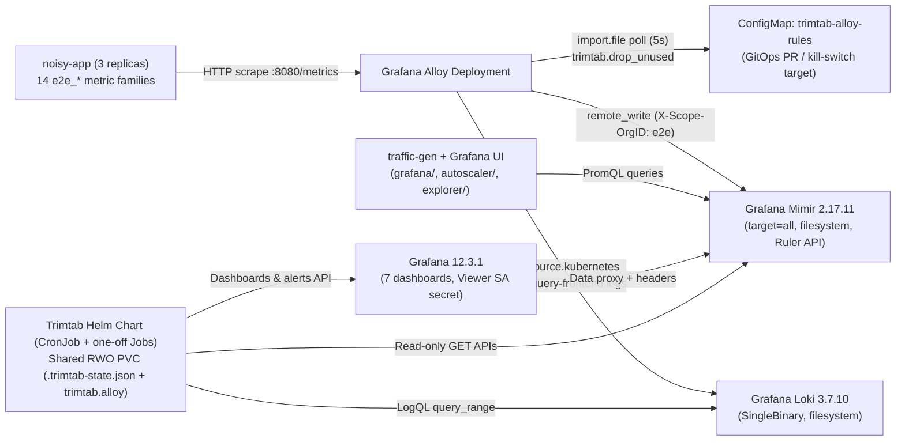

# Trimtab Local Kind End-to-End Test Harness

Reproducible local Kubernetes (`kind`) test harness running a real LGTM observability stack (**Mimir**, **Loki**, **Grafana**, **Grafana Alloy**) alongside Trimtab (`charts/trimtab`) and controlled workloads (`noisy-app`, `traffic-gen`), asserting Trimtab's safety invariants scenario by scenario (`S0`–`S14`).

For empirically discovered product bugs, safety findings, and docs/code discrepancies, see **[FINDINGS.md](FINDINGS.md)**.

---

## Architecture



---

## Prerequisites

- **OS / Hardware:** Linux (tested on x86_64) targeting a **16 GB laptop** (entire `trimtab-e2e-control-plane` cluster uses ~1.3–1.5 GiB RSS in Docker with resource limits bounded well under 6 GB).
- **Required CLI Tools:**
  - `docker` (daemon running and accessible)
  - `kind` (tested with `v0.23.0`)
  - `kubectl` (tested with `v1.30.2`)
  - `helm` (tested with `v4.3.0`)
  - `jq` (tested with `jq-1.8.1`)
  - `curl`
- *(Optional)* `mimirtool` — **not required**; `e2e.sh` loads rule groups directly via Mimir's Ruler HTTP API (`POST /prometheus/config/v1/rules/<namespace>`).

All image tags, chart versions, and Kind node digests are pinned in [versions.env](versions.env) (zero `:latest` tags).

### Resource Budget

| Workload | Namespace | CPU Req / Lim | Mem Req / Lim | Notes |
| :--- | :--- | :--- | :--- | :--- |
| Mimir (`target=all`) | `monitoring` | `200m` / `1000m` | `384Mi` / `1536Mi` | `emptyDir` blocks/tsdb/rules |
| Loki (`SingleBinary`) | `monitoring` | `100m` / `500m` | `256Mi` / `768Mi` | `emptyDir`, no memcached caches |
| Grafana | `monitoring` | `100m` / `500m` | `192Mi` / `512Mi` | `NodePort :30300`, ephemeral storage |
| Alloy | `monitoring` | `100m` / `500m` | `192Mi` / `512Mi` | Single Deployment pod |
| `noisy-app` (x3) | `monitoring` | `20m` / `100m` ea | `24Mi` / `64Mi` ea | Controlled ~4,161 `e2e_*` series |
| `traffic-gen` | `monitoring` | `20m` / `100m` | `24Mi` / `64Mi` | Simulated callers + regret switch |
| Trimtab Jobs / CronJob | `trimtab` | `100m` / `500m` | `128Mi` / `384Mi` | Runs on demand + 256Mi RWO PVC |

---

## Quickstart & Commands

Run everything from scratch (`up -> build -> deploy -> seed -> test`):

```bash
make e2e-all
```

Or drive each stage individually:

| Target / Command | Purpose | Expected Runtime |
| :--- | :--- | :--- |
| `make e2e-up` (`./test/e2e/e2e.sh up`) | Create `trimtab-e2e` Kind cluster & install Mimir/Loki/Grafana/Alloy + SA secret | ~2–4 min |
| `make e2e-build` (`./test/e2e/e2e.sh build`) | Build `trimtab:e2e`, `noisy-app`, `traffic-gen` images and load into Kind | ~1–2 min |
| `make e2e-deploy` (`./test/e2e/e2e.sh deploy`) | Install `charts/trimtab` with `values/trimtab-e2e.yaml` & run pre-seed `helm test` | ~20 sec |
| `make e2e-seed` (`./test/e2e/e2e.sh seed`) | Deploy workloads, load Mimir Ruler rules, seed 7 Grafana dashboards, trigger queries | ~1–2 min |
| `make e2e-test` (`./test/e2e/e2e.sh test`) | Run scenarios `S0`–`S14` sequentially and write `artifacts/<timestamp>/summary.md` | ~38–42 min (20m window + 5m staleness + 5m soak) |
| `make e2e-scenario S=S7` | Run one scenario in isolation (assumes cluster is seeded) | ~10 sec – 11 min depending on scenario |
| `./test/e2e/e2e.sh reset` | Wipe `.trimtab-state.json` & `trimtab.alloy` on PVC, restore pass-through & fresh stores, re-seed | ~1–2 min |
| `make e2e-artifacts` | Print path of the latest `test/e2e/artifacts/<UTC-timestamp>` run | instant |
| `make e2e-down` | Delete the `trimtab-e2e` Kind cluster | ~10 sec |

Artifacts written per run in `test/e2e/artifacts/<UTC-timestamp>/`:
- `summary.md` (PASS / FAIL / FINDING / SKIPPED table)
- `S*/report*.json`, `S*/ledger-before.json`, `S*/ledger-after.json`, `S*/trimtab*.alloy`, raw command logs
- `pod-logs/` (`mimir.log`, `loki.log`, `grafana.log`, `alloy.log`, `traffic-gen.log`)

---

## Mimir Query-Frontend Logging Verification

Real Mimir `2.17.11` flags used in [`values/mimir.yaml`](values/mimir.yaml):

```yaml
frontend:
  query_stats_enabled: true
  log_queries_longer_than: 0s
  log_query_request_headers: "User-Agent,X-Dashboard-UID,X-Grafana-User,X-Scope-OrgID"
```

- **`query_stats_enabled: true`** is what emits a `msg="query stats"` logfmt line for every PromQL `/query` and `/query_range` request with `param_query=...` and `user_agent=...`.
- **`log_queries_longer_than: 0s`** disables Mimir's separate `msg="slow query detected"` logger (note: `1ns` emits a duplicate `caller=handler.go:315 msg="slow query detected"` line that omits `user_agent=`, which breaks Trimtab's `User-Agent: trimtab/...` self-query exclusion — see [`FINDINGS.md#F3a`](FINDINGS.md#f3a-mimir-slow-query-detected-omits-user_agent-breaking-self-query-exclusion-trimtab-marks-the-entire-cluster-live)).
- **Sample captured Mimir query log line (from Loki):**
  ```text
  ts=2026-11-25T19:29:54.554646711Z caller=handler.go:430 level=info user=e2e msg="query stats" component=query-frontend method=GET path=/prometheus/api/v1/query_range route_name=prometheus_api_v1_query_range user_agent=grafana/12.3.1 status_code=200 response_time=474.4µs ... param_end=2026-11-25T19:29:54Z param_query="sum by (pod) (e2e_rotation_gauge)" param_start=2026-11-25T19:19:54Z param_step=30000 ... header_user_agent=grafana/12.3.1 header_x_scope_orgid=e2e status=success
  ```
- **Grafana header forwarding:** With Grafana `[dataproxy] send_user_header = true` (`values/grafana.yaml`) and `log_query_request_headers: "User-Agent,X-Dashboard-UID,X-Grafana-User,X-Scope-OrgID"`, authenticated Grafana dashboard queries include both `header_x_grafana_user=admin` and `header_x_dashboard_uid=<uid>` in Mimir logs (`caller=handler.go:430 ... header_x_dashboard_uid=e2e-cardinality-explorer header_x_grafana_user=admin`). However, Trimtab's current logfmt parser does not extract `header_x_dashboard_uid` ([`FINDINGS.md#F3c`](FINDINGS.md#f3c-header_x_dashboard_uid-is-ignored-in-mimir-logfmt-so-dashboard_uid-exclusions-do-not-suppress-live-grafana-queries)).

---

## Alloy Insertion Point & Reload Method

Alloy mounts ConfigMap `trimtab-alloy-rules` (`monitoring` namespace) as a **directory** at `/etc/alloy/trimtab` (not `subPath`, so kubelet symlink atomic swaps propagate) and loads it via:

```alloy
import.file "trimtab" {
  filename       = "/etc/alloy/trimtab/trimtab.alloy"
  detector       = "poll"
  poll_frequency = "5s"
}
```

When [`apply_alloy_module`](lib/trimtab.sh) updates the ConfigMap, it waits for the pod's mounted `/etc/alloy/trimtab/trimtab.alloy` SHA-256 checksum to match and then triggers an immediate `POST http://alloy.monitoring.svc.cluster.local:12345/-/reload`.

---

## Watching Live in Grafana & Mimir

Kind maps NodePorts `30300` (Grafana) and `30808` (Mimir) to `localhost`, or use `kubectl port-forward`:

```bash
# Grafana (main consolidated dashboard: http://localhost:30300/d/e2e-overview)
kubectl -n monitoring port-forward svc/grafana 3000:80
kubectl -n monitoring get secret grafana -o jsonpath='{.data.admin-password}' | base64 -d; echo

# Mimir Prometheus & Ruler HTTP API (requires header X-Scope-OrgID: e2e)
kubectl -n monitoring port-forward svc/mimir 8080:8080

# Loki HTTP API
kubectl -n monitoring port-forward svc/loki 3100:3100
```

---

## 3 AM Kill-Switch Procedure (Restore All Dropped Metrics)

If an active drop ever impacts production telemetry, restore full ingestion immediately without restarting workloads or touching Trimtab's PVC ledger:

```bash
kubectl -n monitoring create configmap trimtab-alloy-rules --from-file=trimtab.alloy=/dev/stdin --dry-run=client -o yaml <<'EOF' | kubectl apply -f -
declare "drop_unused" {
  argument "forward_to" { optional = false }
  export "receiver" { value = prometheus.relabel.trimtab_drop.receiver }
  prometheus.relabel "trimtab_drop" { forward_to = argument.forward_to.value }
}
EOF

# Trigger immediate reload (or wait up to 5s for Alloy's poll / kubelet ConfigMap sync)
kubectl -n monitoring exec e2e-curl -- curl -sf -X POST http://alloy.monitoring.svc.cluster.local:12345/-/reload
```

All previously dropped series resume remote-writing into Mimir on the next 15s scrape (`S14`).

---

## Troubleshooting

- **Mimir `query-frontend` logs missing in Loki:** Verify `alloy` can reach `loki.monitoring.svc.cluster.local:3100` (`kubectl -n monitoring logs deployment/alloy -c alloy`) and verify Mimir pod carries label `component=query-frontend`.
- **Series stay non-zero past 5 minutes after applying `trimtab.alloy`:** Check Mimir TSDB staleness (~5m after the last scraped sample stops); verify Alloy picked up the updated ConfigMap inside the container (`kubectl -n monitoring exec deployment/alloy -c alloy -- cat /etc/alloy/trimtab/trimtab.alloy`).
- **Stuck `pending-install` Helm release for `trimtab`:** Never pass `--wait` to `helm upgrade --install` on `WaitForFirstConsumer` storage classes when deploying only a CronJob; run `helm uninstall trimtab -n trimtab` and reinstall without `--wait`.
- **Resetting state completely between runs:** `./test/e2e/e2e.sh reset` wipes `.trimtab-state.json` and `trimtab.alloy` from the `trimtab-state` PVC and flushes Mimir/Loki `emptyDir` stores cleanly.
